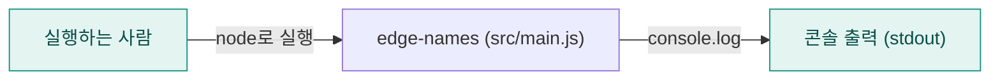
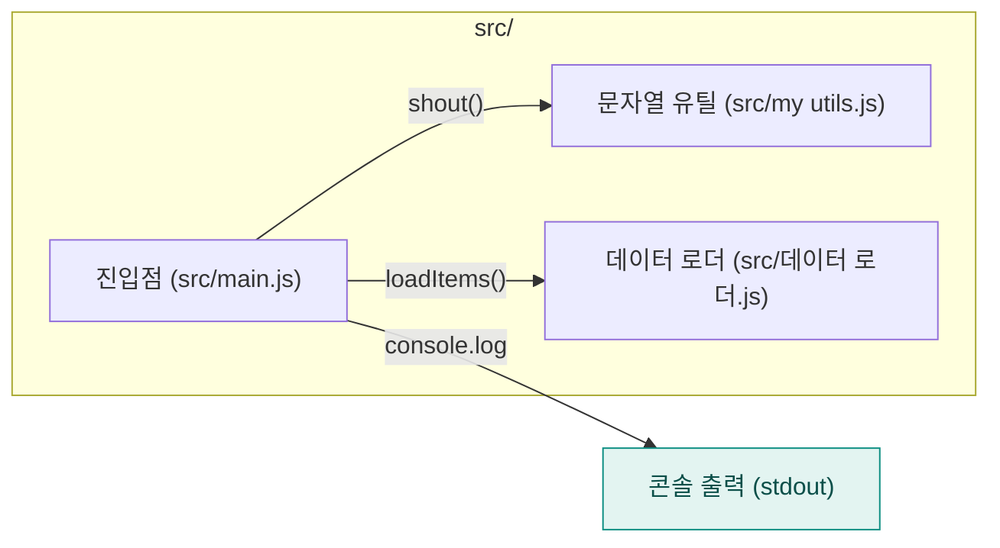

<!-- codemap: generated file — hand edits outside a manual-edit block are replaced by /codemap refresh -->

# 아키텍처 개요

`edge-names`는 공백과 한글이 들어간 파일 이름을 다루는 아주 작은 Node.js(CommonJS) 프로젝트이며, 아래에서 세 단계로 확대하며 구조를 보여 줍니다.

## 1단계: 시스템 컨텍스트

사람이 `package.json`의 `main`으로 지정된 `src/main.js`를 실행하면, 프로그램은 결과를 콘솔(표준 출력)에만 씁니다. 데이터베이스나 외부 API 호출은 코드에서 발견되지 않았습니다.

## 2단계: 컨테이너

배포 단위는 `src/` 폴더의 Node.js 스크립트 하나뿐이며, 서버·워커·저장소 같은 별도 프로세스는 없습니다.

## 3단계: 컴포넌트

`src/main.js`가 두 모듈을 `require`로 불러와 `loadItems()`로 얻은 각 항목을 `shout()`으로 바꿔 출력하며, 두 모듈은 서로를 부르지 않습니다.

## 다루지 않은 범위

저장소의 소스 3개(`src/main.js`, `src/my utils.js`, `src/데이터 로더.js`)와 `package.json`, `README.md`를 모두 읽었습니다. 다만 `src/데이터 로더.js`는 경로에 한글이 있어 해시 안전 규칙(허용 문자 제한)을 통과하지 못해 front matter의 `sources`에서 빠져 있습니다 (확인 필요) <!-- codemap:unverified -->.
