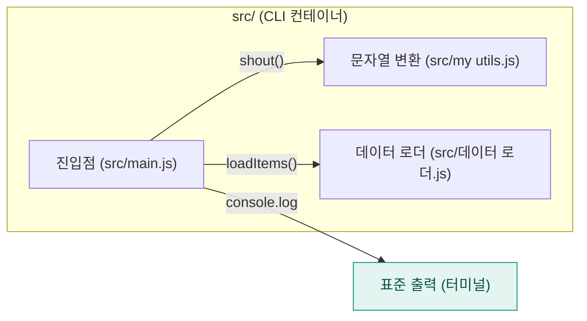

<!-- codemap: generated file — hand edits outside a manual-edit block are replaced by /codemap refresh -->

# 아키텍처 개요

`edge-names`는 항목 목록을 불러와 대문자로 바꾼 뒤 터미널에 출력하는 아주 작은 Node.js 프로그램이며, 아래에 세 단계의 확대 수준으로 구조를 보여 줍니다.

## 1단계: 시스템 컨텍스트

사용자가 `src/main.js`를 실행하면 프로그램이 결과 줄을 표준 출력으로 내보냅니다.

## 2단계: 컨테이너

배포 단위는 `src/` 폴더의 스크립트 하나뿐이며, 서버·데이터베이스·네트워크 호출은 코드에서 찾지 못했습니다.

## 3단계: 컴포넌트

`src/main.js`가 `src/데이터 로더.js`에서 항목을 받고, 각 항목을 `src/my utils.js`의 `shout()`로 변환해 출력합니다. `src/데이터 로더.js`는 모듈 안의 고정 배열(`alpha`, `beta`, `gamma`)을 복사해 돌려줍니다.

## 다루지 않은 범위

소스 파일 3개(`src/main.js`, `src/my utils.js`, `src/데이터 로더.js`)와 `package.json`을 모두 읽었으며, 읽지 않은 범위는 없습니다.
