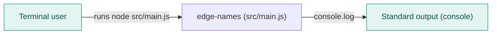
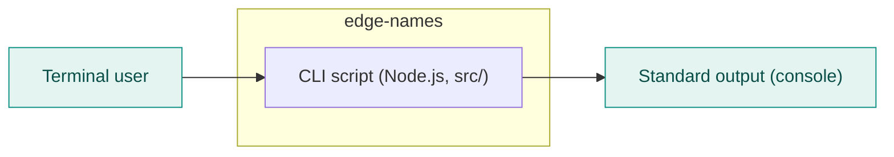
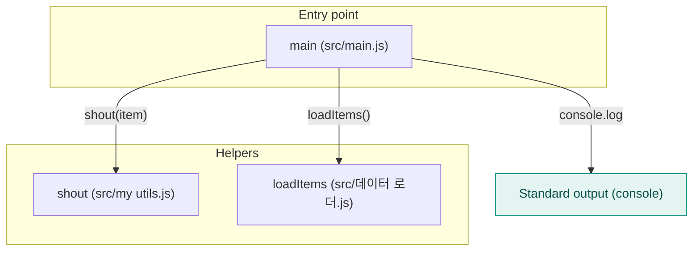

<!-- codemap: generated file — hand edits outside a manual-edit block are replaced by /codemap refresh -->

# Architecture overview

`edge-names` is a tiny Node.js (CommonJS) program that prints a fixed list of items in upper case; this page shows it at three zoom levels.

## Level 1: System context

The system is one command-line program that writes to standard output; no database, network or other external service is referenced in the code.

## Level 2: Containers

There is a single deployable part: the Node.js script in `src/`, started through `src/main.js` (`main` in `package.json`).

## Level 3: Components

`src/main.js` asks `src/데이터 로더.js` for the items, formats each with `src/my utils.js`, and prints the result.

## Not covered

The repository was read completely (3 source files, `package.json`, `README.md`); nothing was skipped.
