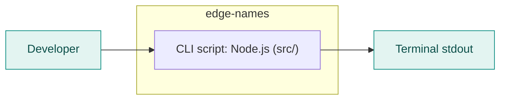
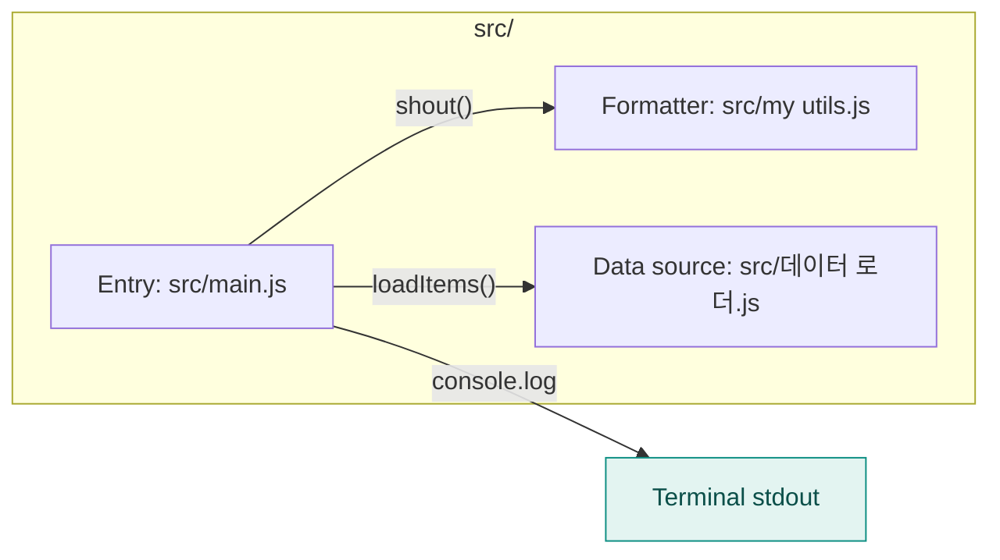

<!-- codemap: generated file — hand edits outside a manual-edit block are replaced by /codemap refresh -->

# Architecture overview

`edge-names` is a tiny Node.js command-line script that loads three items, upper-cases them and prints them.

## System context

The only things around the system are the person who runs `src/main.js` and the terminal that receives the output; no database or network call appears in the code.

## Containers

There is a single container: one Node.js script whose entry point is `src/main.js`, as declared by `main` in `package.json`.

## Components

`src/main.js` pulls the items from `src/데이터 로더.js`, formats each with `src/my utils.js` and prints the result.

## Not covered

Nothing was skipped: all three source files, `package.json` and `README.md` were read in full. There is no build output, vendored code or test folder.
