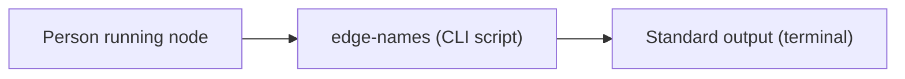
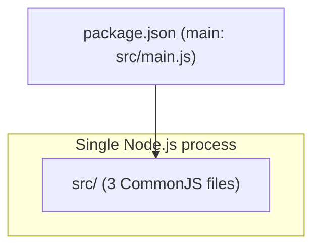
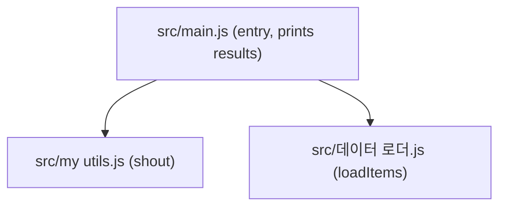

<!-- codemap: generated file — hand edits outside a manual-edit block are replaced by /codemap refresh -->

# Architecture: edge-names

## Level 1 — System context

A person runs the script with Node.js and it prints one line per item to standard output. It uses no database, network or other external system.

## Level 2 — Containers

The project is one Node.js process whose entry point is declared in `package.json` as `src/main.js`.

## Level 3 — Components

`src/main.js` loads items through `loadItems` in `src/데이터 로더.js` and formats each one through `shout` in `src/my utils.js`.

## Not covered
The whole repository (4 source/manifest files) was read; nothing was skipped.
