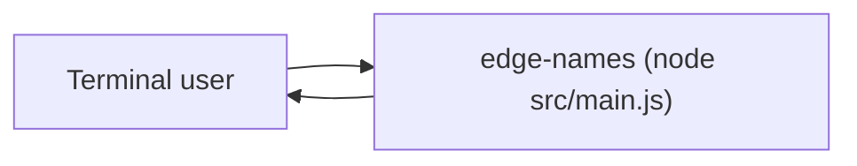
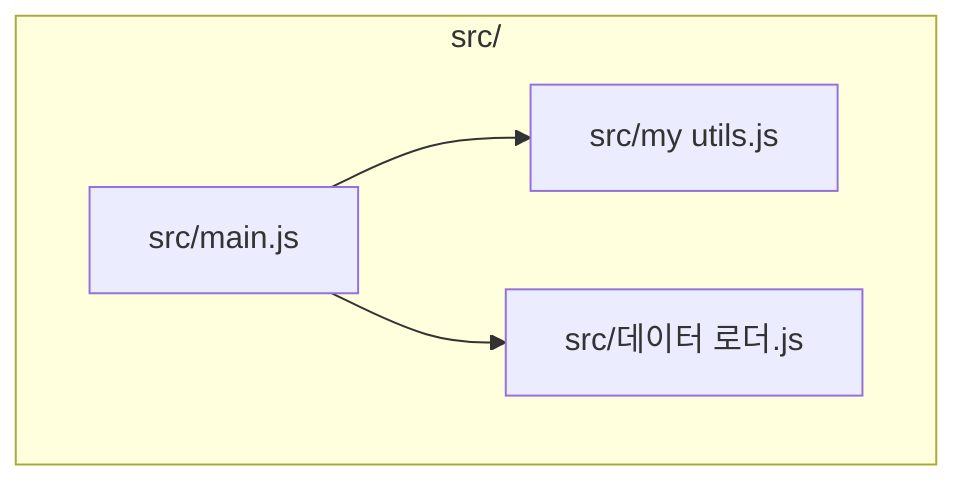

<!-- codemap: generated file — hand edits outside a manual-edit block are replaced by /codemap refresh -->

# Architecture

## Context

The program is run from a terminal and prints to stdout.

## Components

`src/main.js` requires the other two modules and combines their results.

## Not covered
The repo was read completely. `src/데이터 로더.js` was read but is not listed in `sources` because its non-ASCII file name fails the safe-hashing rule (needs your decision).
