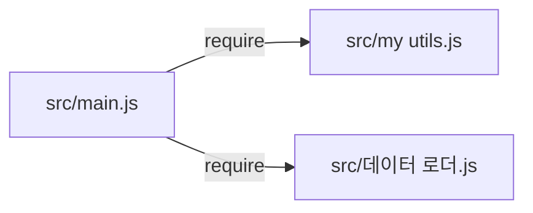

<!-- codemap: generated file — hand edits outside a manual-edit block are replaced by /codemap refresh -->

# Dependency graph

Only `src/main.js` has imports; there are no circular dependencies and no third-party packages.

## Not covered
The repo was read completely. `src/데이터 로더.js` is not listed in `sources` because its non-ASCII file name fails the safe-hashing rule (needs your decision).
