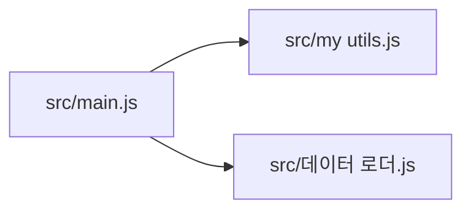

<!-- codemap: generated file — hand edits outside a manual-edit block are replaced by /codemap refresh -->

# 의존성 그래프

소스 파일이 서로 `require`하는 관계를 실제 코드에서 읽어 그렸으며, 화살표는 불러오는 파일에서 불러와지는 파일로 향합니다.

`src/main.js`가 나머지 두 파일을 `require`하고, 두 파일은 다른 프로젝트 파일을 불러오지 않습니다.

## 순환 의존

순환 의존은 발견되지 않았습니다. 모든 간선이 `src/main.js`에서 바깥쪽으로만 향합니다.

## 가장 많이 불러와지는 파일

- `src/my utils.js` — 1회(`src/main.js`가 `shout`를 가져옴)
- `src/데이터 로더.js` — 1회(`src/main.js`가 `loadItems`를 가져옴)

## 다루지 않은 범위

소스 3개를 모두 읽었고 외부 패키지 import는 없었습니다. 동적 `require`는 없었습니다. `src/데이터 로더.js`는 경로에 한글이 있어 해시 안전 규칙을 통과하지 못해 `sources`에 넣지 못했습니다 (확인 필요) <!-- codemap:unverified -->.
