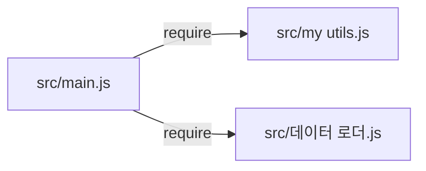

<!-- codemap: generated file — hand edits outside a manual-edit block are replaced by /codemap refresh -->

# Dependency graph: edge-names

## Internal imports

`src/main.js` is the only file with imports: it requires both helper modules, and neither helper imports anything.

## Imports table

| File | Requires | Exports |
|---|---|---|
| `src/main.js` | `src/my utils.js`, `src/데이터 로더.js` | none |
| `src/my utils.js` | none | `shout` |
| `src/데이터 로더.js` | none | `loadItems` |

## Findings
- Circular dependencies: none.
- External (npm) packages: none; `package.json` has no `dependencies` field.
- Note: the `require` strings contain a space and Hangul characters (`./my utils.js`, `./데이터 로더.js`), which Node resolves as normal file names.

## Not covered
The whole repository was read; nothing was skipped.
