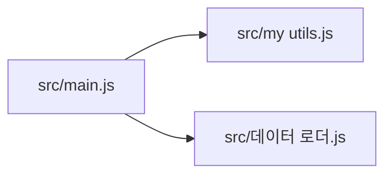

<!-- codemap: generated file — hand edits outside a manual-edit block are replaced by /codemap refresh -->

# Dependency graph

Each arrow points from the file that `require`s to the file it requires, based on the `require(...)` statements in the three source files.

`src/main.js` is the only importer; the two helper files import nothing.

## Circular dependencies

None found: `src/my utils.js` and `src/데이터 로더.js` contain no `require` statements, and there are no self-imports.

## Most depended-on files

- `src/my utils.js`: 1 incoming edge (from `src/main.js`)
- `src/데이터 로더.js`: 1 incoming edge (from `src/main.js`)

## Not covered

All source files were read completely; there are no dynamic imports. Nothing was skipped.
