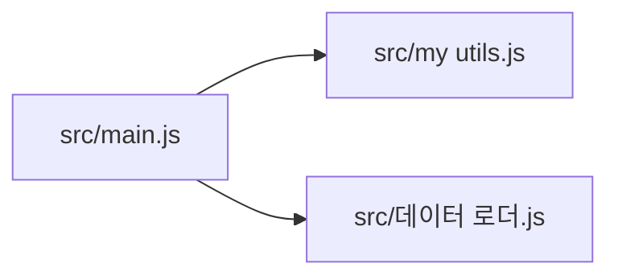

<!-- codemap: generated file — hand edits outside a manual-edit block are replaced by /codemap refresh -->

# 의존성 그래프

각 파일의 `require` 구문을 직접 읽어 만든 그래프이며, 화살표는 가져오는 쪽에서 가져와지는 쪽을 향합니다.

`src/main.js`만 다른 파일 두 개를 가져오고, 나머지 두 파일은 아무것도 가져오지 않습니다.

## 순환 의존

순환 의존은 발견되지 않았습니다. 세 파일의 의존 방향은 `src/main.js`에서 나가는 한 방향뿐입니다.

## 가장 많이 의존되는 파일

- `src/my utils.js`: `src/main.js`가 1번 가져옵니다.
- `src/데이터 로더.js`: `src/main.js`가 1번 가져옵니다.

## 다루지 않은 범위

소스 파일 3개를 모두 읽었고 외부 패키지 import는 없었습니다. 동적 `require`도 없어서 추적하지 못한 의존은 없습니다.
