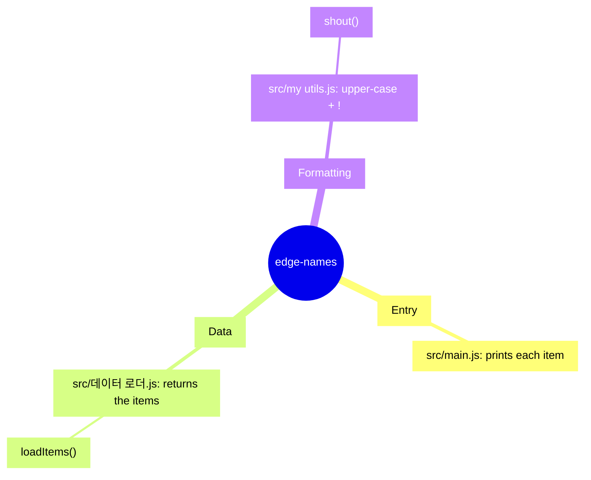

<!-- codemap: generated file — hand edits outside a manual-edit block are replaced by /codemap refresh -->

# Mindmap

The whole project at a glance, grouped by what each file does.

Three groups, one file each; `src/main.js` ties the other two together.

## Groups

- **Entry** — `src/main.js` loops over the items and logs them.
- **Data** — `src/데이터 로더.js` holds the hard-coded list `alpha`, `beta`, `gamma` and returns a copy.
- **Formatting** — `src/my utils.js` upper-cases a string and appends `!`.

No minor items were left out.

## Not covered

Nothing was skipped; every file in the project was read.
