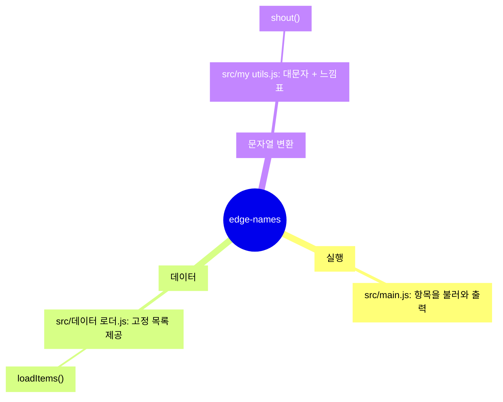

<!-- codemap: generated file — hand edits outside a manual-edit block are replaced by /codemap refresh -->

# 마인드맵

프로젝트 `edge-names`를 하는 일 기준으로 세 갈래로 묶은 한눈에 보는 지도입니다.

중앙의 프로젝트에서 실행, 데이터, 문자열 변환 세 갈래가 뻗어 나갑니다.

## 그룹

- 실행: `src/main.js`가 `package.json`의 `main`으로 지정된 진입점이며 두 모듈을 불러와 결과를 출력합니다.
- 데이터: `src/데이터 로더.js`가 `alpha`, `beta`, `gamma` 배열의 복사본을 돌려줍니다.
- 문자열 변환: `src/my utils.js`가 문자열을 대문자로 바꾸고 `!`를 붙입니다.
- 생략한 항목은 없습니다.

## 다루지 않은 범위

소스 파일 3개를 모두 읽었으며, 읽지 않은 범위는 없습니다.
