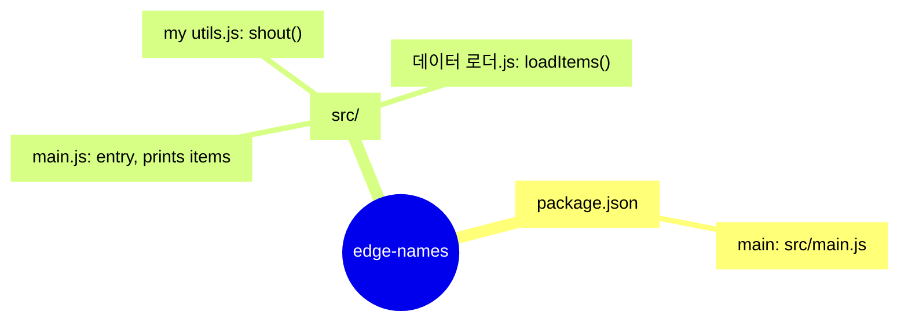

<!-- codemap: generated file — hand edits outside a manual-edit block are replaced by /codemap refresh -->

# Mindmap: edge-names

The project is a tiny Node.js script: `package.json` points at `src/main.js`, which combines a data loader and a text helper.

## Not covered
The whole repository was read; nothing was skipped.
