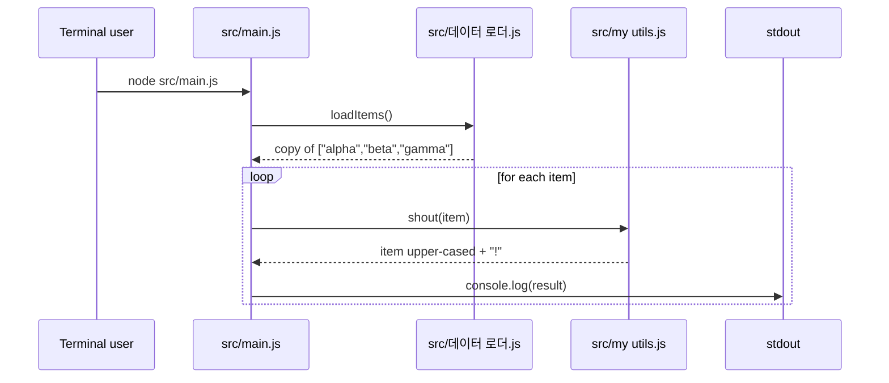

<!-- codemap: generated file — hand edits outside a manual-edit block are replaced by /codemap refresh -->

# Sequence flows

The program has one runtime scenario, so a single flow is shown: running the script.

## Run `node src/main.js`

The user starts the script from a terminal; it loads the items and prints each one shouted.

1. Module load: `src/main.js` requires `shout` and `loadItems` (`src/main.js:require`).
2. `loadItems()` returns `items.slice()` (`src/데이터 로더.js:loadItems`).
3. For each item, `shout(item)` returns `text.toUpperCase() + "!"` (`src/my utils.js:shout`).
4. `console.log` prints `ALPHA!`, `BETA!`, `GAMMA!` (`src/main.js:console.log`).

## Not covered

The repository was read completely. Only one scenario exists; there is no error handling or other branch in the code.
