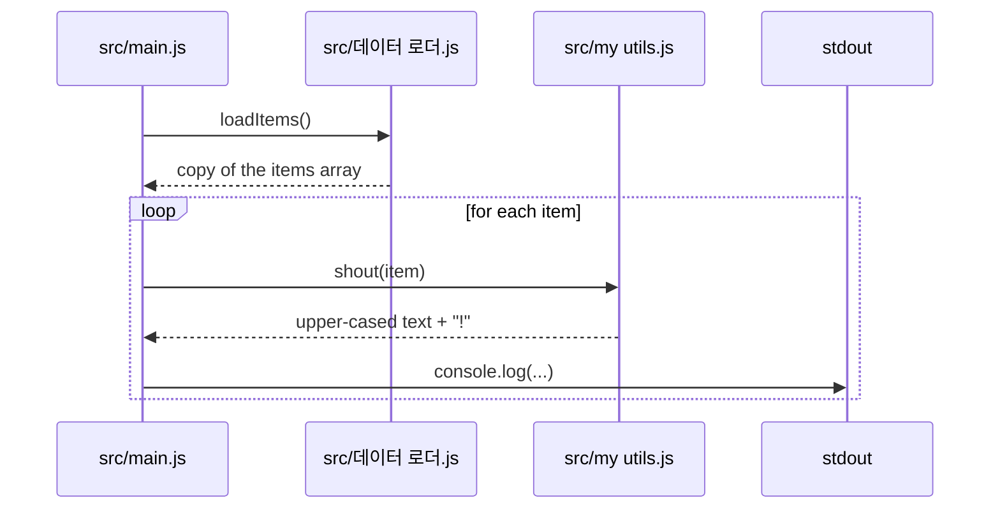

<!-- codemap: generated file — hand edits outside a manual-edit block are replaced by /codemap refresh -->

# Sequence flows

The project has one runtime path, so one scenario is traced; there is no storage, network or error handling to add a second or third.

## Running the script

The developer runs `node src/main.js`, the only entry point.

The loader returns a copy of its three items, and the entry file formats and prints each one in turn.

1. Module load: `src/main.js` requires `shout` and `loadItems` (`src/main.js:require`).
2. `loadItems()` returns `items.slice()` (`src/데이터 로더.js:loadItems`).
3. For each item, `shout(item)` returns `text.toUpperCase() + "!"` (`src/my utils.js:shout`).
4. The result is printed with `console.log` (`src/main.js:console.log`).

## Not covered

Nothing was skipped; every function on the path was read. Output was derived from the code and the script was not executed.
