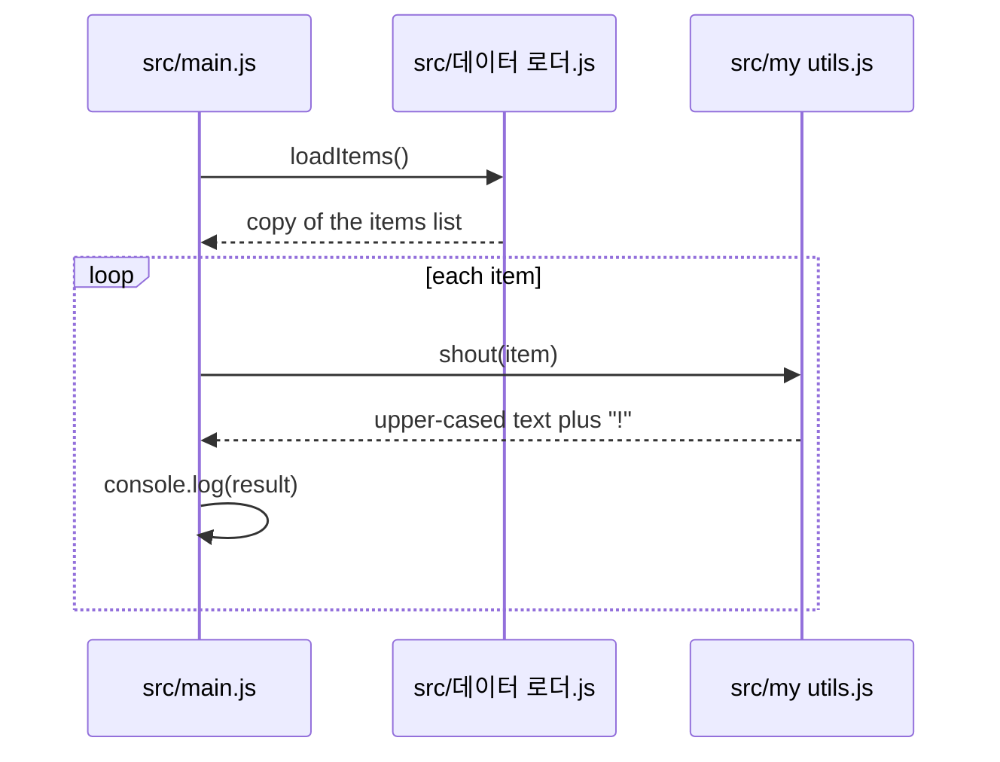

<!-- codemap: generated file — hand edits outside a manual-edit block are replaced by /codemap refresh -->

# Sequence flow: `node src/main.js`

Items are loaded once, then each one is upper-cased and printed, giving `ALPHA!`, `BETA!`, `GAMMA!`.

## Not covered
The repo was read completely. `src/데이터 로더.js` is not listed in `sources` because its non-ASCII file name fails the safe-hashing rule (needs your decision).
