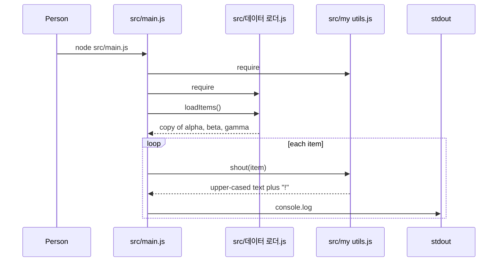

<!-- codemap: generated file — hand edits outside a manual-edit block are replaced by /codemap refresh -->

# Sequence flow: edge-names

## Scenario: running the script

On start, `src/main.js` requires both helpers, loads the three items, and prints each one upper-cased with a trailing exclamation mark (ALPHA!, BETA!, GAMMA!).

## Not covered
The whole repository was read; the script was not executed, so the printed output is derived from reading the code.
