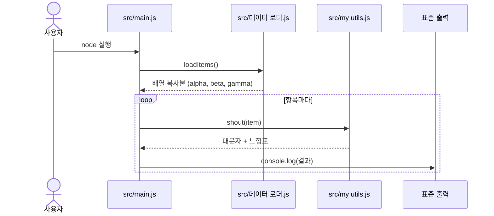

<!-- codemap: generated file — hand edits outside a manual-edit block are replaced by /codemap refresh -->

# 시퀀스 흐름

프로그램에는 실행 경로가 하나뿐이어서 시나리오를 하나만 골랐습니다. 분기나 오류 처리 코드가 없어 다른 시나리오는 만들지 않았습니다.

## 프로그램 실행: 항목을 대문자로 출력

사용자가 `src/main.js`를 실행하면 시작됩니다.

1. 시작 시 `src/main.js`가 `require`로 두 모듈을 불러옵니다 (`src/main.js:shout`, `src/main.js:loadItems`).
2. `src/main.js`가 `loadItems()`를 호출하고, `src/데이터 로더.js:loadItems`가 내부 배열의 `slice()` 복사본을 돌려줍니다.
3. `for...of` 반복에서 각 항목마다 `src/my utils.js:shout`를 호출해 `toUpperCase()`에 `"!"`를 붙인 문자열을 받습니다.
4. 받은 문자열을 `src/main.js`가 `console.log`로 출력합니다. 결과는 `ALPHA!`, `BETA!`, `GAMMA!` 순서입니다.

## 다루지 않은 범위

소스 파일 3개를 모두 읽었으며, 읽지 않은 범위는 없습니다. 추적하지 못한 호출도 없습니다.
