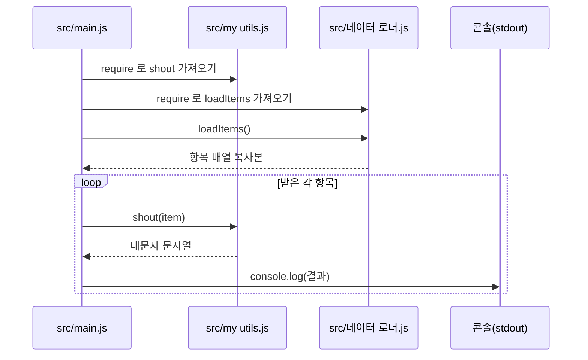
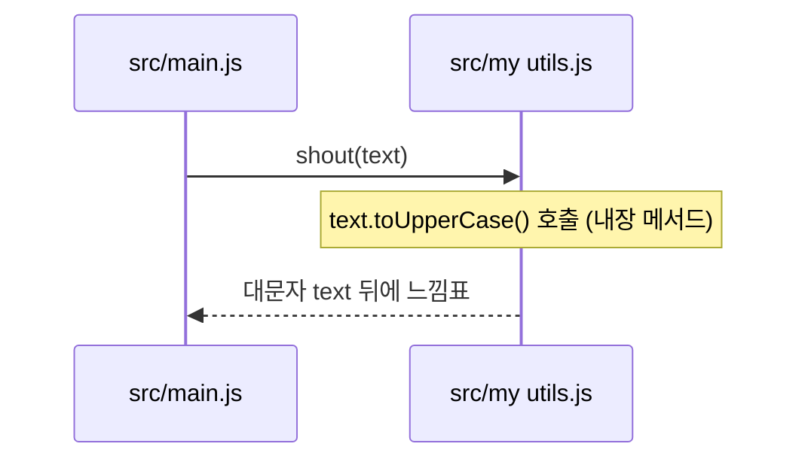

<!-- codemap: generated file — hand edits outside a manual-edit block are replaced by /codemap refresh -->

# 시퀀스 흐름

프로그램이 실제로 어떤 순서로 호출하는지 코드에서 따라가 두 가지 시나리오로 그렸습니다.

## 프로그램을 실행해 모든 항목을 출력하기

진입점 `src/main.js`가 실행되면 모듈을 불러오고 항목 목록을 받아 하나씩 출력합니다.

두 모듈은 맨 위에서 먼저 로드되고, 이후 반복문이 항목마다 변환과 출력을 수행합니다.

1. `src/main.js` 맨 위에서 `require("./my utils.js")`로 `shout`를 가져옵니다.
2. `src/main.js`에서 `require("./데이터 로더.js")`로 `loadItems`를 가져옵니다.
3. `src/main.js`가 `src/데이터 로더.js:loadItems`를 호출해 `items.slice()` 복사본을 받습니다.
4. `for...of` 반복에서 항목마다 `src/my utils.js:shout`를 호출합니다.
5. 반환된 문자열을 `src/main.js`가 `console.log`로 출력합니다.

## 항목 하나를 대문자로 바꾸기

`shout`가 호출되면 문자열을 대문자로 바꾸고 느낌표를 붙여 돌려줍니다.

이 함수는 다른 파일을 부르지 않고 JavaScript 내장 `toUpperCase`만 사용합니다.

1. `src/main.js`가 `src/my utils.js:shout`에 항목을 넘깁니다.
2. `src/my utils.js:shout`가 `text.toUpperCase() + "!"`를 계산합니다.
3. 결과 문자열이 `src/main.js`로 돌아갑니다.

오류 처리 경로(try/catch, 입력 검사)는 코드에 없어 세 번째 시나리오는 만들지 않았습니다.

## 다루지 않은 범위

소스 3개를 모두 읽었고 추적하지 못한 호출은 없습니다. `src/데이터 로더.js`는 경로에 한글이 있어 해시 안전 규칙을 통과하지 못해 `sources`에 넣지 못했습니다 (확인 필요) <!-- codemap:unverified -->.
