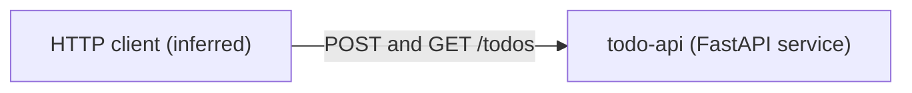
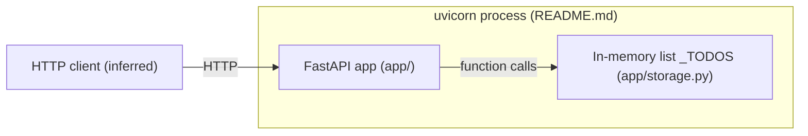
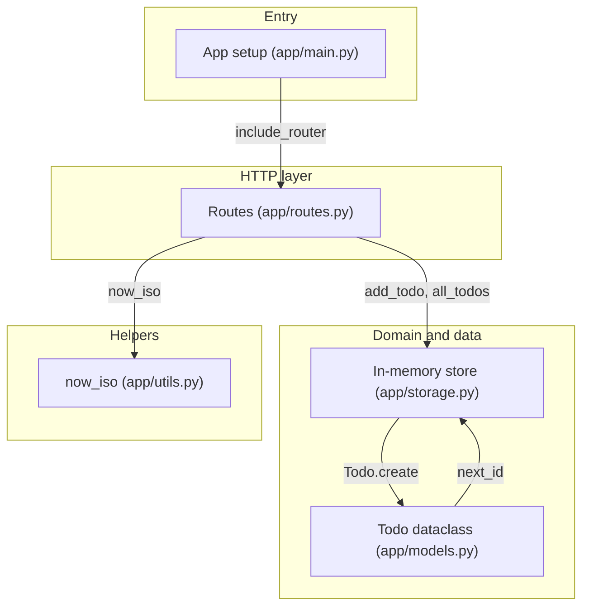

# Architecture overview

`todo-api` is a tiny FastAPI service (see `pyproject.toml`, `README.md`) shown here at three zoom levels.

## Level 1: System context

The service is one system reached over HTTP; no database or third-party API is referenced anywhere in the code.

The HTTP client is inferred from the routes in `app/routes.py`; no client code exists in the repo. <!-- codemap:unverified -->

## Level 2: Containers

There is a single deployable process, started with `uvicorn app.main:app` per `README.md`; todos live in a module-level list inside it, so they are lost on restart.

## Level 3: Components

`app/main.py` mounts the router from `app/routes.py`, which delegates persistence to `app/storage.py`; `app/models.py` and `app/storage.py` import each other (a deliberate cycle per the comments in both files).

## Not covered

All 6 Python files, `pyproject.toml` and `README.md` were read completely. `app/__init__.py` is empty. There are no tests, config files or deployment files in the repo. Nothing was skipped.
