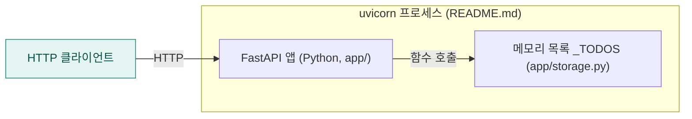
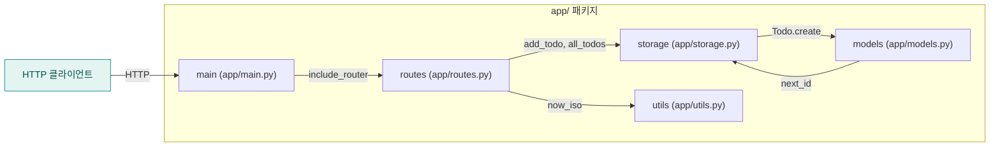

<!-- codemap: generated file — hand edits outside a manual-edit block are replaced by /codemap refresh -->

# 아키텍처 개요

`todo-api`는 FastAPI로 만든 작은 할 일(todo) REST 서비스이며, 아래에서 시스템 맥락, 컨테이너, 컴포넌트 순서로 세 단계로 확대해 설명합니다.

## 시스템 맥락

사용자(HTTP 클라이언트)가 `/todos` 경로로 요청을 보내고 JSON을 돌려받는 단일 시스템이며, 코드에서 확인된 외부 데이터베이스나 타사 API는 없습니다.

## 컨테이너

배포 단위는 `uvicorn app.main:app`으로 실행되는 하나의 프로세스이고, 데이터는 별도 DB 없이 같은 프로세스의 파이썬 리스트에 저장됩니다.

## 컴포넌트

`app/main.py`가 `FastAPI` 앱을 만들어 `app/routes.py`의 라우터를 등록하고, 라우트는 `app/storage.py`와 `app/utils.py`를 호출하며, `app/storage.py`와 `app/models.py`는 서로를 호출합니다.

- `app/main.py`: `FastAPI(title="todo-api")` 생성과 `include_router(router)`.
- `app/routes.py`: `POST /todos`(`create_todo`)와 `GET /todos`(`list_todos`).
- `app/models.py`: `Todo` 데이터클래스(`to_dict`, `create`).
- `app/storage.py`: 모듈 전역 `_TODOS` 리스트와 `next_id`, `add_todo`, `all_todos`.
- `app/utils.py`: UTC 현재 시각을 ISO 문자열로 돌려주는 `now_iso`.

## 다루지 않은 범위

저장소의 소스 파일(`app/*.py`, 총 65줄)과 `pyproject.toml`, `README.md`를 모두 읽었습니다. 테스트, 배포 설정, 실제 실행은 저장소에 없거나 확인하지 않았습니다.
