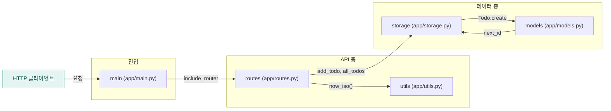

<!-- codemap: generated file — hand edits outside a manual-edit block are replaced by /codemap refresh -->

# 아키텍처 개요

`todo-api`는 FastAPI로 만든 작은 할 일 관리 서비스입니다. 아래에서 시스템 맥락, 컨테이너, 컴포넌트 순서로 확대해 가며 구조를 보여 줍니다.

## 1. 시스템 맥락

사용자(HTTP 클라이언트)가 `todo-api`에 요청을 보내는 구조이며, 코드에서 확인된 외부 시스템은 없습니다(데이터베이스나 외부 API 호출 없음).

## 2. 컨테이너

실행은 `README.md`에 적힌 `uvicorn app.main:app` 한 프로세스이고, 데이터는 별도 DB 없이 같은 프로세스의 모듈 전역 리스트에만 보관됩니다.

## 3. 컴포넌트 (FastAPI 앱 내부)

`app/main.py`가 앱을 만들어 `app/routes.py`의 라우터를 붙이고, 라우트는 `app/storage.py`와 `app/utils.py`를 부릅니다. `app/storage.py`와 `app/models.py`는 서로를 import하는 순환 관계이며 코드 주석이 "deliberate cycle"이라고 적고 있습니다(자세한 내용은 `dependency-graph.md`).

## 다루지 않은 범위

저장소의 소스 파일 `app/main.py`, `app/routes.py`, `app/storage.py`, `app/models.py`, `app/utils.py`와 `README.md`, `pyproject.toml`을 모두 읽었습니다. `app/__init__.py`는 비어 있습니다. 읽지 않은 범위는 없습니다.
