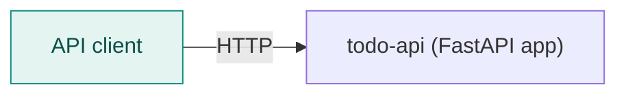
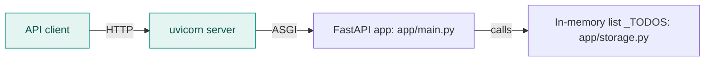
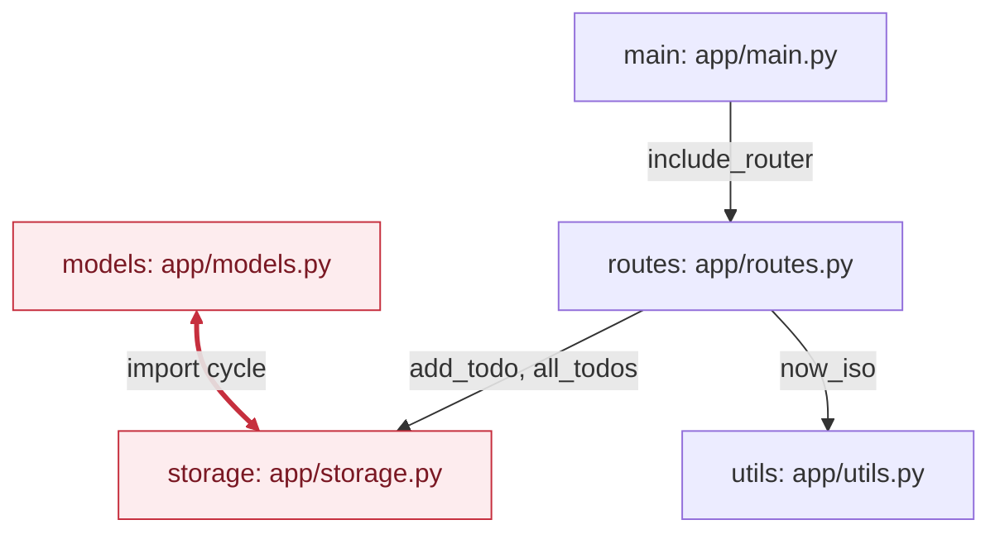

<!-- codemap: generated file — hand edits outside a manual-edit block are replaced by /codemap refresh -->

# todo-api Architecture Overview

`todo-api` is a tiny FastAPI service that creates and lists todos. It keeps all data in a process-local Python list.

## Level 1: System context

An HTTP client calls the single `todo-api` service; there is no database or other external system in the code.

## Level 2: Containers

The README starts the service with `uvicorn app.main:app`; uvicorn hands requests to the FastAPI `app`, which reads and writes the `_TODOS` list in `app/storage.py`. Persistence ends when the process stops, because no file or database is used.

## Level 3: Components

`app/main.py` builds the app and mounts the router from `app/routes.py`; the router calls `app/storage.py` and `app/utils.py`. `app/models.py` and `app/storage.py` import each other, a deliberate cycle noted in the code comments.

| Component | Responsibility |
|---|---|
| `app/main.py` | Creates `FastAPI(title="todo-api")` and includes the router |
| `app/routes.py` | `POST /todos` (validates a non-blank title) and `GET /todos` |
| `app/models.py` | `Todo` dataclass with `to_dict()` and `create()` |
| `app/storage.py` | `_TODOS` list, `next_id()`, `add_todo()`, `all_todos()` |
| `app/utils.py` | `now_iso()` returns the current UTC time as ISO text |

## Not covered

Every file in the repository was read, including the empty `app/__init__.py`. Nothing was executed, so runtime behavior was not tested.
