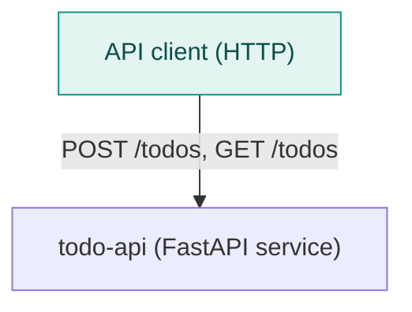
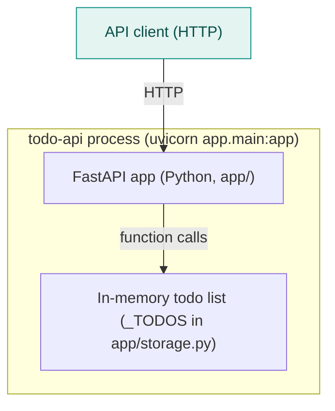
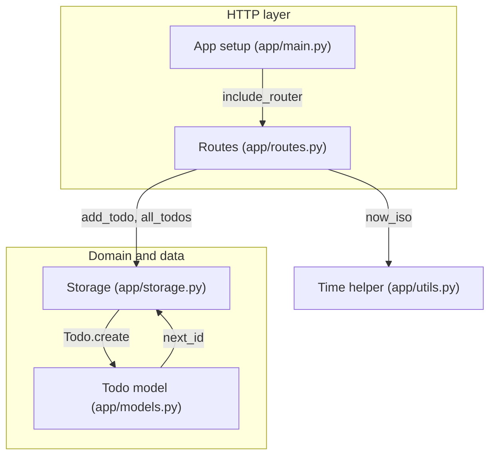

<!-- codemap: generated file — hand edits outside a manual-edit block are replaced by /codemap refresh -->

# Architecture overview

`todo-api` is a tiny FastAPI service that keeps todos in memory, shown at three zoom levels.

## System context

Callers send HTTP requests to the single `todo-api` service; no database or third-party API is referenced in the code.

## Containers

The service is one Python process (run command from `README.md`, dependencies from `pyproject.toml`) whose only state is a module-level list in `app/storage.py`.

## Components

`app/main.py` mounts the router from `app/routes.py`, which delegates to `app/storage.py`; storage and `app/models.py` call each other (a deliberate cycle, see `dependency-graph.md`).

## Not covered

All source files were read (`app/__init__.py` is empty). Nothing was skipped; deployment, tests and CI do not exist in the repository.
