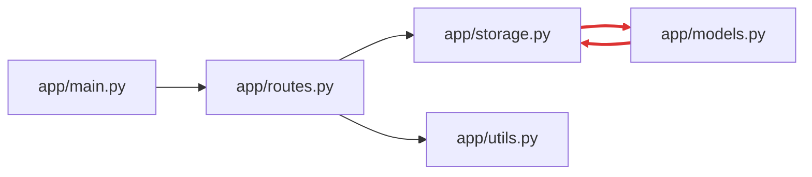

<!-- codemap: generated file — hand edits outside a manual-edit block are replaced by /codemap refresh -->

# Dependency graph

Internal imports between the Python files of `todo-api`; each arrow points from the importer to the imported file.

Red edges mark the one import cycle; third-party imports (`fastapi`, `dataclasses`, `datetime`) are omitted.

## Circular dependencies

- `app/models.py` → `app/storage.py` → `app/models.py`

Both files carry a comment calling the cycle deliberate. Each file only uses the other's attributes inside functions, so the cycle does not fail at import time.

## Most depended-on files

- `app/storage.py`: imported by `app/routes.py` and `app/models.py` (2 incoming)
- `app/models.py`: imported by `app/storage.py` (1 incoming)
- `app/routes.py`: imported by `app/main.py` (1 incoming)
- `app/utils.py`: imported by `app/routes.py` (1 incoming)

## Not covered

All Python files were read completely; `app/__init__.py` is empty and has no imports. No dynamic imports were found.
