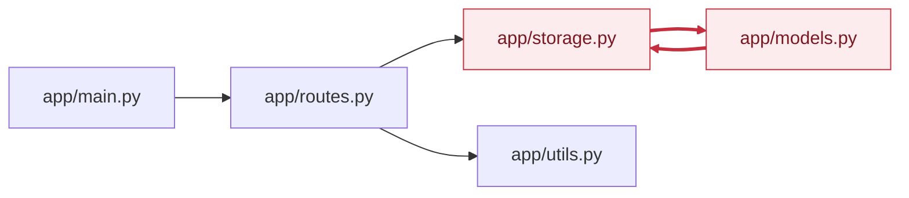

<!-- codemap: generated file — hand edits outside a manual-edit block are replaced by /codemap refresh -->

# Dependency graph

Import edges between the project's own Python files, taken from the import statements that were read.

Arrows point from importer to imported file; the red files and edges form a circular import.

## Circular dependencies

One cyclic group: `app/storage.py` and `app/models.py`. Example cycle: `app/storage.py` → `app/models.py` → `app/storage.py`. Both files carry a comment calling the cycle deliberate. It works because each module only uses the other inside functions, after both are loaded.

## Most depended-on files

- `app/storage.py`: imported by `app/routes.py` and `app/models.py` (2 incoming edges).
- `app/models.py`: imported by `app/storage.py` (1).
- `app/routes.py`: imported by `app/main.py` (1).
- `app/utils.py`: imported by `app/routes.py` (1).

## Not covered

Third-party imports (`fastapi`, `dataclasses`, `datetime`) are ignored. `app/__init__.py` is empty. All other source files were read; nothing was skipped.
