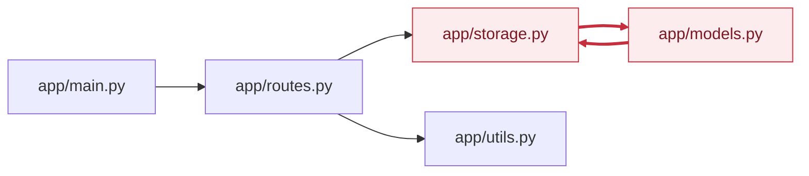

<!-- codemap: generated file — hand edits outside a manual-edit block are replaced by /codemap refresh -->

# 의존성 그래프

각 파일의 import 문을 직접 읽어 "누가 누구를 가져오는가"를 화살표(importer → imported)로 그렸습니다. 서드파티 패키지(`fastapi`, `dataclasses`, `datetime`)는 제외했습니다.

`app/storage.py`와 `app/models.py`가 서로를 가져오는 순환(빨간 화살표)이 있고, 나머지는 `app/main.py` → `app/routes.py` → 저장소/유틸 순의 한 방향 흐름입니다.

## 순환 의존

순환 그룹이 1개 있습니다.

- 파일: `app/storage.py`, `app/models.py`
- 예시 순환: `app/storage.py` → `app/models.py` → `app/storage.py`
- 근거: `app/storage.py`의 `from app import models`와 `app/models.py`의 `from app import storage`. 두 줄 모두 주석에 "deliberate cycle"이 적혀 있습니다.
- 두 import가 모듈 최상단에서 `from app import ...` 형태로 모듈 객체만 가져오고 사용은 함수 안에서 하므로, 실행 시점에는 동작하는 구조로 보입니다 (추정) <!-- codemap:unverified -->

## 가장 많이 import되는 파일

- `app/storage.py` — 2회 (`app/routes.py`, `app/models.py`)
- `app/models.py` — 1회 (`app/storage.py`)
- `app/routes.py` — 1회 (`app/main.py`)
- `app/utils.py` — 1회 (`app/routes.py`)

`app/__init__.py`는 비어 있어 import도 피import도 없습니다. 동적 import나 플러그인 로딩은 코드에서 발견되지 않았습니다.

## 다루지 않은 범위

`app/` 아래 파이썬 파일 6개를 모두 읽었습니다. 읽지 않은 범위는 없습니다.
