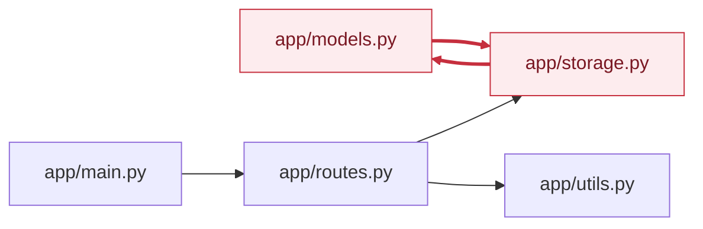

<!-- codemap: generated file — hand edits outside a manual-edit block are replaced by /codemap refresh -->

# 의존성 그래프

각 파일의 `import` 문을 직접 읽어 프로젝트 내부 파일 사이의 import 관계(importer → imported)를 그렸습니다.

`app/main.py`에서 `app/routes.py`를 거쳐 `app/storage.py`와 `app/utils.py`로 내려가며, 붉은 선으로 표시한 `app/models.py`와 `app/storage.py`는 서로를 import합니다. 외부 패키지(`fastapi`, `dataclasses`, `datetime`)는 제외했고, `app/__init__.py`는 비어 있어 간선이 없습니다.

## 순환 의존

- 순환 그룹 1개: `app/models.py`, `app/storage.py`
  - 예시 순환: `app/models.py` → `app/storage.py` → `app/models.py`
  - 근거: `app/models.py`의 `from app import storage`와 `app/storage.py`의 `from app import models`. 두 파일 모두 주석으로 "deliberate cycle"이라고 적고 있어 의도된 순환입니다.
  - 두 import 모두 모듈 최상단에 있고 함수 안에서만 상대 모듈의 속성을 쓰기 때문에 import 시점에는 문제가 되지 않는 구조입니다. 다만 실제 실행으로 확인하지는 않았습니다. <!-- codemap:unverified -->

## 가장 많이 import되는 파일

- `app/storage.py`: 2회 (`app/routes.py`, `app/models.py`)
- `app/models.py`: 1회 (`app/storage.py`)
- `app/routes.py`: 1회 (`app/main.py`)
- `app/utils.py`: 1회 (`app/routes.py`)

## 다루지 않은 범위

`app/` 아래 모든 파이썬 파일을 읽었고 동적 import나 리플렉션은 발견하지 못했습니다. 테스트 코드는 저장소에 없습니다.
