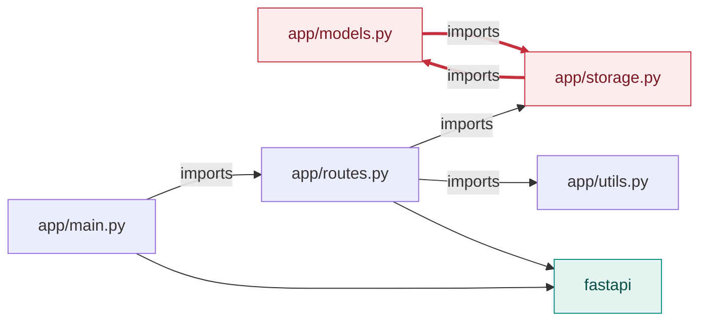

<!-- codemap: generated file — hand edits outside a manual-edit block are replaced by /codemap refresh -->

# todo-api Dependency Graph

This graph comes from the real `import` statements in `app/`. It shows one circular dependency.

## Internal import graph

An arrow means "imports". `app/main.py` leads to `app/routes.py`, which uses `app/storage.py` and `app/utils.py`; `fastapi` is the only third-party import. The standard library (`dataclasses`, `datetime`) is left out.

## Circular dependency

- `app/models.py` has `from app import storage` and `app/storage.py` has `from app import models`. Both files mark the cycle as deliberate in a comment.
- The cycle is only used inside function bodies (`storage.next_id()` in `Todo.create`, `models.Todo.create` in `add_todo`), not at import time. <!-- codemap:unverified --> (inferred from reading; the app was not run to confirm the import order works)

## Not covered

All five Python modules were read. `app/__init__.py` is empty. Standard-library and installed-package internals were not examined.
