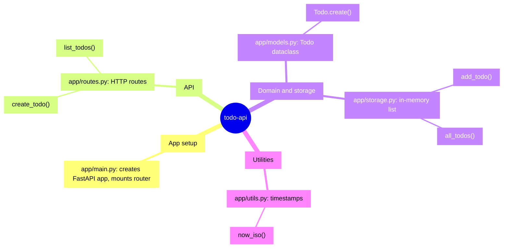

<!-- codemap: generated file — hand edits outside a manual-edit block are replaced by /codemap refresh -->

# Mindmap

`todo-api` at a glance: four responsibilities, each backed by one small file.

Every branch maps to a file in `app/`; the leaves are the public functions that matter.

## Groups

- **App setup**: `app/main.py` builds the `FastAPI` instance and includes the router.
- **API**: `app/routes.py` exposes `POST /todos` and `GET /todos`.
- **Domain and storage**: `app/models.py` defines `Todo`; `app/storage.py` keeps todos in a module-level list. Left out: `to_dict()` and `next_id()`.
- **Utilities**: `app/utils.py` returns the current UTC time as an ISO string.

## Not covered

All Python files were read completely; `app/__init__.py` is empty. Nothing was skipped.
