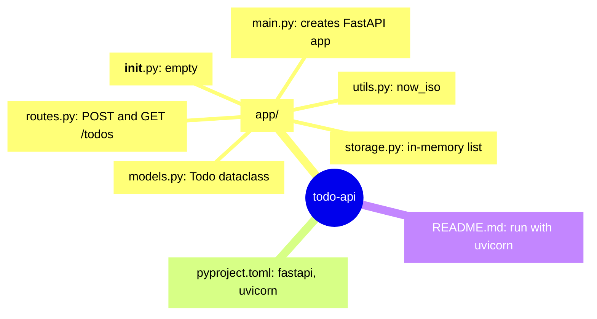

<!-- codemap: generated file — hand edits outside a manual-edit block are replaced by /codemap refresh -->

# todo-api Mindmap

## Project at a glance

The whole project is one `app/` package with five working modules, plus a manifest and a short README.

## Not covered

Every file in the repository was read.
