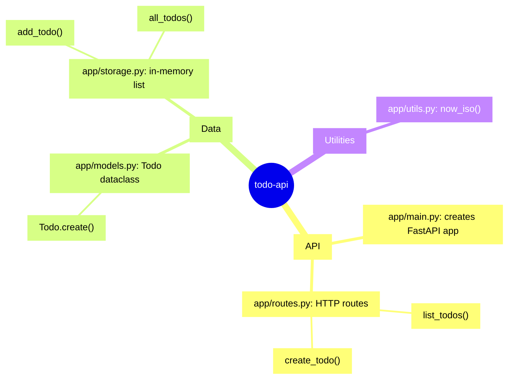

<!-- codemap: generated file — hand edits outside a manual-edit block are replaced by /codemap refresh -->

# Mindmap

The `todo-api` project grouped by what its code does.

The map shows three groups: the HTTP API, the todo data and storage, and a small time helper.

## Groups

- API: builds the app and exposes `POST /todos` and `GET /todos` (`app/main.py`, `app/routes.py`).
- Data: the `Todo` dataclass and the in-memory store behind it (`app/models.py`, `app/storage.py`).
- Utilities: a UTC timestamp helper (`app/utils.py`). `app/storage.py` also has `next_id()`, left out of the map.

## Not covered

All source files were read; `app/__init__.py` is empty. Nothing was skipped.
