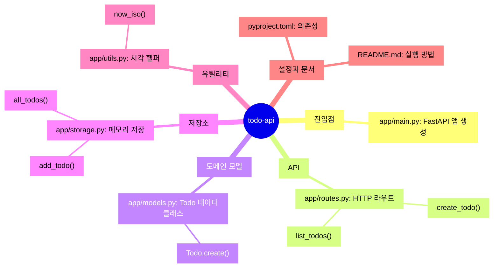

<!-- codemap: generated file — hand edits outside a manual-edit block are replaced by /codemap refresh -->

# 마인드맵

`todo-api` 프로젝트를 기능 단위로 한눈에 보는 지도입니다.

모든 파일이 `app/` 패키지 아래 다섯 개의 역할로 나뉘고, 설정과 문서가 그 바깥에 있다는 것을 보여 줍니다.

## 그룹

- 진입점: `app/main.py`가 `FastAPI` 앱을 만들고 라우터를 등록합니다.
- API: `app/routes.py`의 `POST /todos`, `GET /todos`.
- 도메인 모델: `app/models.py`의 `Todo`(필드 `id`, `title`, `created_at`, `done`).
- 저장소: `app/storage.py`의 메모리 리스트 `_TODOS`. 생략한 항목: `next_id()`.
- 유틸리티: `app/utils.py`의 `now_iso()`.
- 설정과 문서: `pyproject.toml`(`fastapi`, `uvicorn` 의존성), `README.md`. 비어 있는 `app/__init__.py`는 지도에서 뺐습니다.

## 다루지 않은 범위

모든 소스 파일을 읽었으며 생략한 것은 위에 적은 `next_id()`와 비어 있는 `app/__init__.py`뿐입니다.
