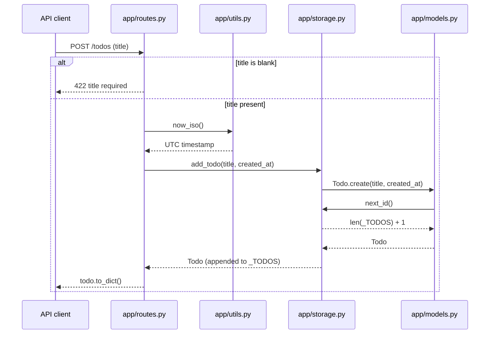
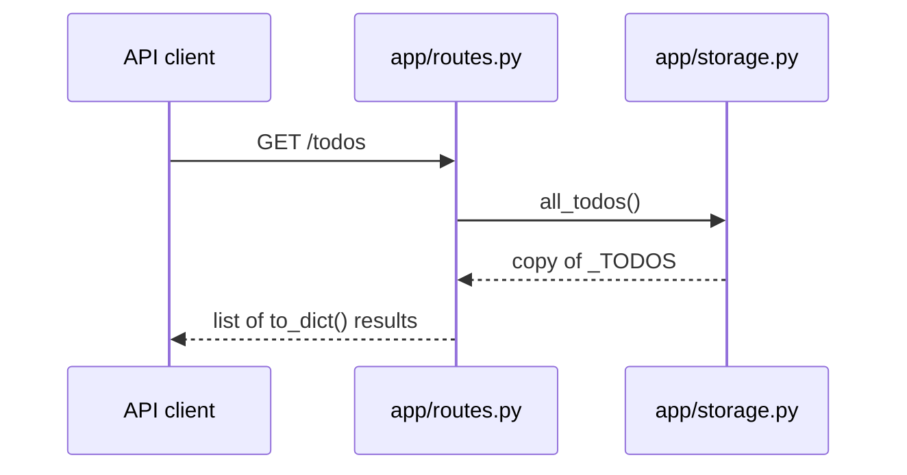

<!-- codemap: generated file — hand edits outside a manual-edit block are replaced by /codemap refresh -->

# todo-api Sequence Flows

## Scenario 1: POST /todos (create a todo)

`create_todo` in `app/routes.py` rejects a blank title with HTTP 422. Otherwise it stamps the time, and `app/storage.py` asks `app/models.py` to build the `Todo` (which gets its id back from `app/storage.py`) before appending it to the list.

The `title` argument is a plain `str` parameter, which FastAPI treats as a query parameter. <!-- codemap:unverified --> (framework behavior, not run)

## Scenario 2: GET /todos (list todos)

`list_todos` in `app/routes.py` copies the stored list through `all_todos()` and returns each todo as a dict.

## Not covered

All modules on both paths were read. Nothing was executed, so the HTTP-level behavior (status codes, parameter parsing) comes from reading the code only.
