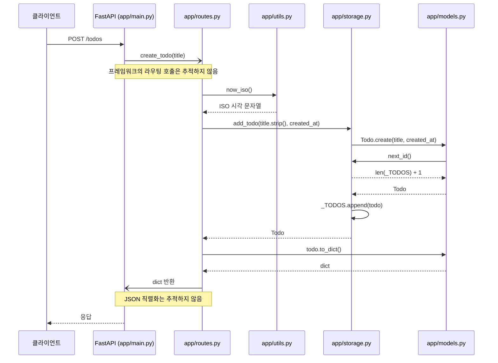
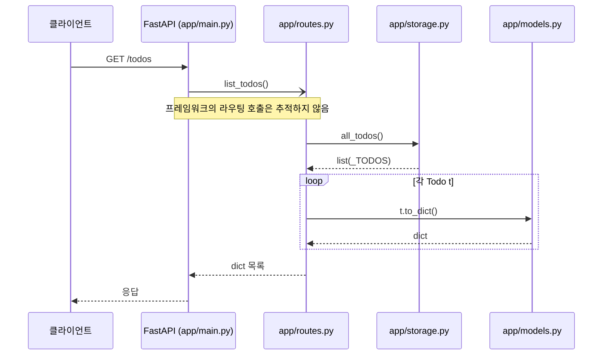
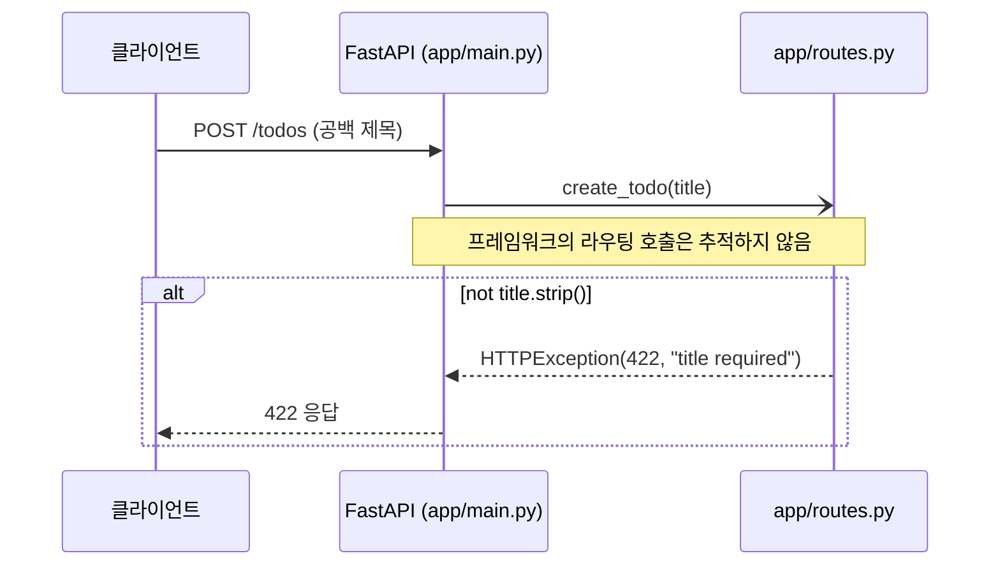

<!-- codemap: generated file — hand edits outside a manual-edit block are replaced by /codemap refresh -->

# 시퀀스 흐름

가장 중심인 `POST /todos`, 목록을 읽는 `GET /todos`, 그리고 제목이 비었을 때의 오류 경로, 이 세 가지 실행 흐름을 코드에서 따라가며 그렸습니다.

## POST /todos: 할 일 만들기

클라이언트가 `title`과 함께 `POST /todos`를 호출하면 시작됩니다.

라우터 함수 호출과 응답 직렬화는 FastAPI 내부 동작이라 따라가지 않았습니다(추정). <!-- codemap:unverified -->

1. `app/main.py`: `app.include_router(router)`로 등록된 라우트가 요청을 받습니다.
2. `app/routes.py:create_todo`: 제목이 비어 있지 않은지 검사합니다(아래 오류 흐름 참고).
3. `app/utils.py:now_iso`: UTC 현재 시각을 ISO 문자열로 만듭니다.
4. `app/storage.py:add_todo`: `Todo`를 만들어 `_TODOS`에 넣습니다.
5. `app/models.py:Todo.create`: `app/storage.py:next_id`로 id를 받아 `Todo`를 만듭니다.
6. `app/models.py:Todo.to_dict`: 응답용 dict로 바꿉니다.

## GET /todos: 목록 조회

클라이언트가 `GET /todos`를 호출하면 시작됩니다.

저장소는 `list(_TODOS)`로 복사본을 돌려주므로 라우트가 원본 리스트를 직접 바꾸지 않습니다.

1. `app/routes.py:list_todos`: 목록 조회 라우트입니다.
2. `app/storage.py:all_todos`: `_TODOS`의 복사본을 반환합니다.
3. `app/models.py:Todo.to_dict`: 각 항목을 dict로 바꿔 리스트 컴프리헨션으로 모읍니다.

## POST /todos: 제목이 비었을 때

`title.strip()`이 빈 문자열이면 저장소를 거치지 않고 오류로 끝납니다.

이 경우 `app/utils.py`, `app/storage.py`, `app/models.py`는 호출되지 않습니다.

1. `app/routes.py:create_todo`: `if not title.strip()` 조건에서 `HTTPException(status_code=422, detail="title required")`를 발생시킵니다.

## 다루지 않은 범위

`app/` 아래 모든 파일을 읽었습니다. FastAPI와 uvicorn 내부(요청 파싱, 라우팅, 직렬화)는 라이브러리 코드라 읽지 않았고, 실제로 서버를 실행해 확인하지도 않았습니다.
