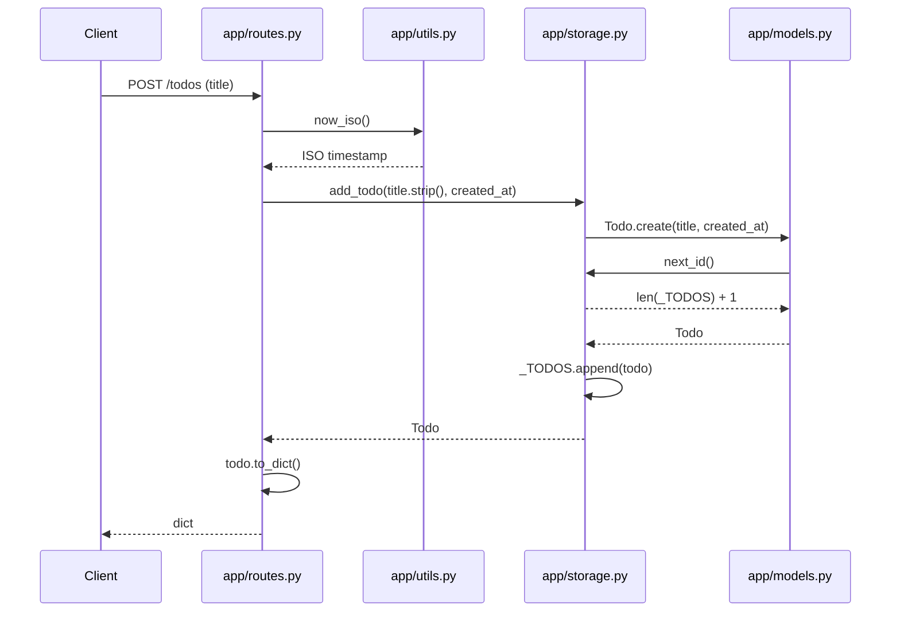
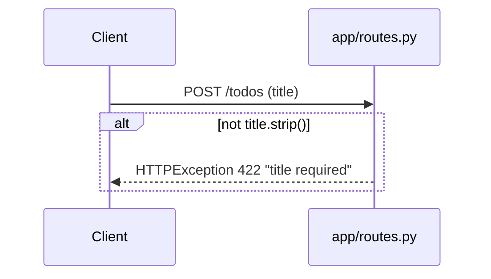
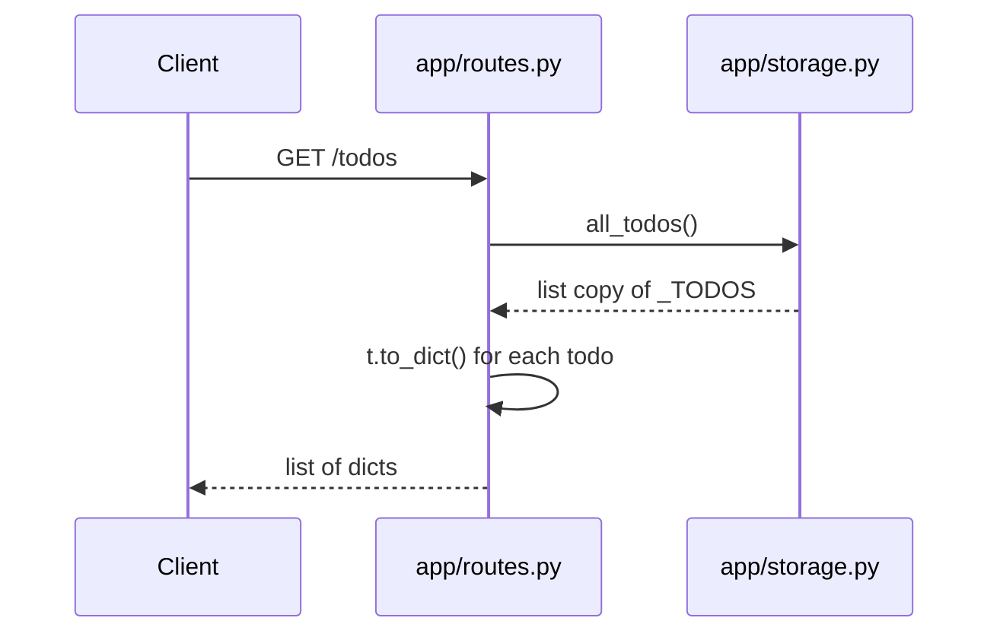

<!-- codemap: generated file — hand edits outside a manual-edit block are replaced by /codemap refresh -->

# Sequence flows

Three runtime scenarios traced through the code: creating a todo, rejecting an empty title, and listing todos.

## Create a todo

A client sends `POST /todos` with a non-empty `title`.

1. `app/routes.py:create_todo` checks the title, then calls `now_iso()` for the timestamp.
2. `app/utils.py:now_iso` returns the current UTC time as an ISO string.
3. `app/storage.py:add_todo` asks the model to build the todo.
4. `app/models.py:Todo.create` calls `app/storage.py:next_id` for the id.
5. `app/storage.py:add_todo` appends the todo to `_TODOS` and returns it.
6. `app/routes.py:create_todo` returns `todo.to_dict()` (`app/models.py:Todo.to_dict`).

## Create a todo with an empty title

A client sends `POST /todos` with a blank `title`.

1. `app/routes.py:create_todo` strips the title and, if it is empty, raises `HTTPException(status_code=422, detail="title required")`. Storage is never called.

## List todos

A client sends `GET /todos`.

1. `app/routes.py:list_todos` calls `app/storage.py:all_todos`, which returns a copy of the list.
2. `app/routes.py:list_todos` converts each todo with `app/models.py:Todo.to_dict` and returns the list.

Request routing from `app/main.py` (`app.include_router(router)`) is done by FastAPI and is not drawn.

## Not covered

All source files were read; `app/__init__.py` is empty. FastAPI's internal request handling is not traced.
