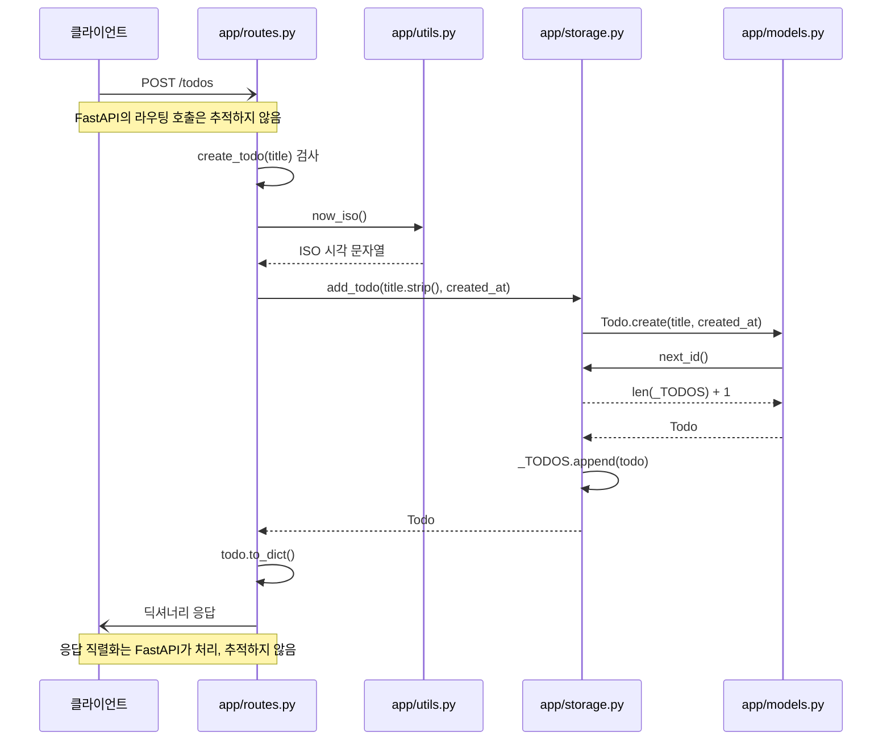
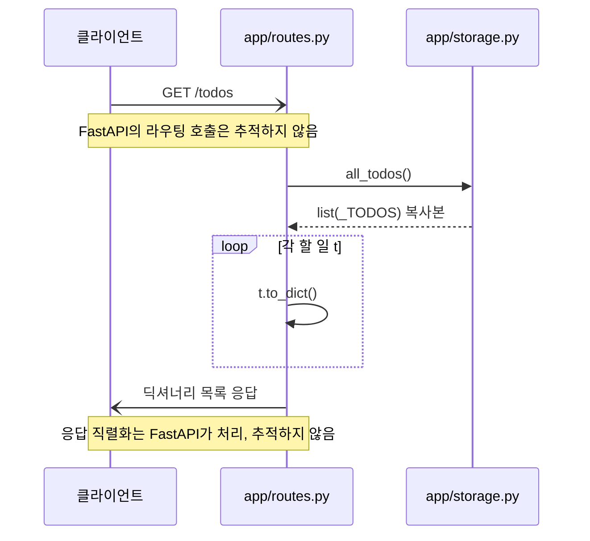
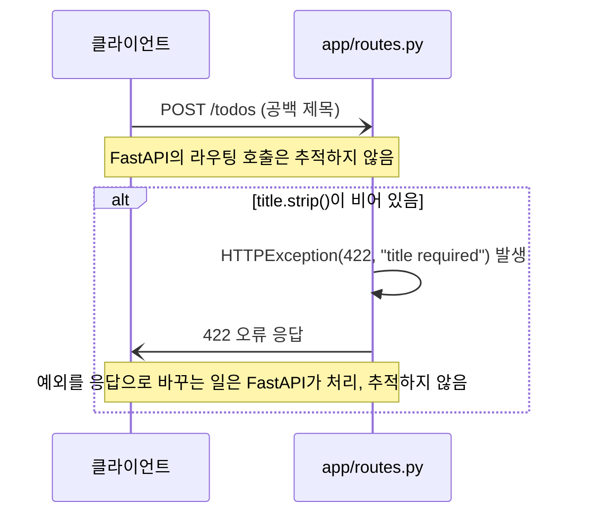

<!-- codemap: generated file — hand edits outside a manual-edit block are replaced by /codemap refresh -->

# 시퀀스 흐름

실제 코드를 따라가며 세 가지 시나리오를 그렸습니다. 고른 이유: (1) `POST /todos`는 가장 중심이 되는 쓰기 동작, (2) `GET /todos`는 저장소를 읽는 동작, (3) 빈 제목은 코드에 있는 유일한 오류 경로입니다. 열린 화살표(`-)`)는 FastAPI 프레임워크가 내부에서 처리해 따라가지 않은 구간입니다.

## POST /todos — 할 일 추가

클라이언트가 `POST /todos`로 제목을 보내면 `create_todo()`가 실행됩니다.

라우트가 시각을 만들고 저장소에 넘기면, 저장소가 모델에게 객체 생성을 맡기고 모델이 다시 저장소에서 id를 받아 오는 순환 호출이 일어납니다. FastAPI가 요청을 라우트 함수로 연결하고 반환값을 응답으로 바꾸는 부분은 읽지 않았습니다. 또한 `title`이 쿼리 파라미터로 전달된다는 점도 FastAPI의 기본 동작에 대한 추정입니다. <!-- codemap:unverified -->

1. `app/routes.py:create_todo` — `title.strip()`이 비었는지 검사
2. `app/utils.py:now_iso` — 현재 UTC 시각을 ISO 문자열로 반환
3. `app/storage.py:add_todo` — `Todo.create`를 호출해 객체를 만들고 `_TODOS`에 추가
4. `app/models.py:Todo.create` — `storage.next_id()`로 id를 받아 `Todo` 생성
5. `app/storage.py:next_id` — `len(_TODOS) + 1` 반환
6. `app/routes.py:create_todo` — `todo.to_dict()`를 반환

## GET /todos — 목록 조회

클라이언트가 `GET /todos`를 호출하면 `list_todos()`가 저장된 모든 할 일을 딕셔너리로 바꿔 돌려줍니다.

저장소는 내부 리스트의 복사본만 돌려주므로 라우트가 원본을 바꾸지 않습니다. 프레임워크 구간은 위와 같이 추적하지 않았습니다. <!-- codemap:unverified -->

1. `app/routes.py:list_todos` — 저장소 목록 요청
2. `app/storage.py:all_todos` — `list(_TODOS)` 반환
3. `app/routes.py:list_todos` — 각 `Todo`에 `to_dict()` 호출

## POST /todos — 빈 제목 오류

제목이 공백뿐이면 저장소에 닿기 전에 422 오류로 끝납니다.

이 경로에서는 `app/utils.py`, `app/storage.py`, `app/models.py`가 호출되지 않습니다. 예외 처리는 프레임워크 동작이라 읽지 않았습니다. <!-- codemap:unverified -->

1. `app/routes.py:create_todo` — 조건 `not title.strip()`이 참이면 `HTTPException(status_code=422, detail="title required")`를 발생

## 다루지 않은 범위

`app/routes.py`, `app/storage.py`, `app/models.py`, `app/utils.py`, `app/main.py`를 읽었습니다. FastAPI 내부(라우팅, 직렬화, 예외 처리)는 라이브러리 코드라 읽지 않았습니다.
