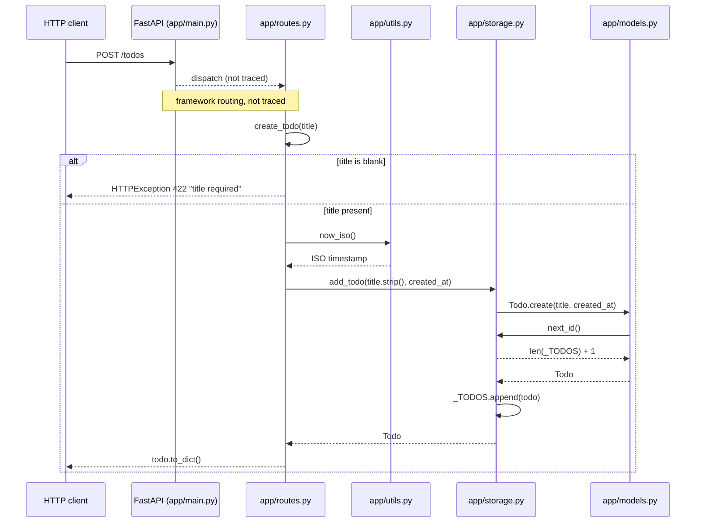
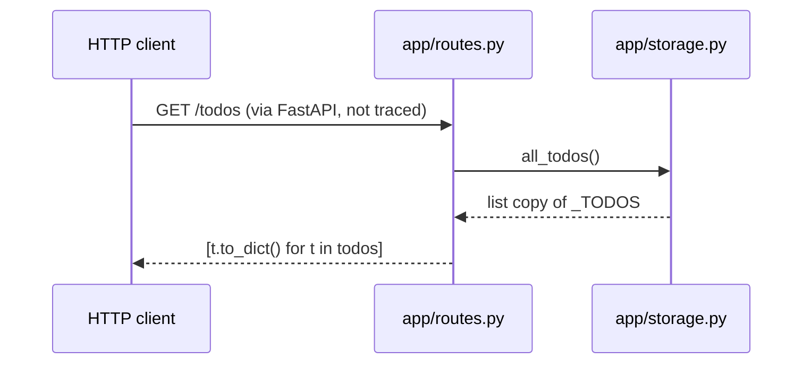

# Sequence flows

Two runtime scenarios traced through the code: creating a todo (including its validation error path) and listing todos.

## Create a todo (POST /todos)

Triggered when a client posts to `/todos` with a `title`; this is the main write operation and it touches storage and the model.

The route validates the title, stamps the time, and storage asks the model to build a `Todo` whose id comes back from storage.

1. Client sends the request; `app/main.py` registered the router via `app.include_router(router)`.
2. FastAPI calls `app/routes.py:create_todo`.
3. If `title.strip()` is empty it raises `HTTPException(422)`: `app/routes.py:create_todo`.
4. Otherwise it gets a timestamp: `app/utils.py:now_iso`.
5. It calls `app/storage.py:add_todo`.
6. Storage calls `app/models.py:Todo.create`, which calls `app/storage.py:next_id`.
7. Storage appends the todo to `_TODOS` and returns it; the route returns `Todo.to_dict()` (`app/models.py:Todo.to_dict`).

The framework dispatch step is not traced because FastAPI's internals were not read. <!-- codemap:unverified -->

## List todos (GET /todos)

Triggered when a client requests `/todos`; it only reads from storage.

The route copies the stored list and serialises each `Todo`.

1. FastAPI calls `app/routes.py:list_todos`.
2. It calls `app/storage.py:all_todos`, which returns `list(_TODOS)`.
3. Each item is converted with `app/models.py:Todo.to_dict`.

## Not covered

All Python files were read completely. FastAPI/uvicorn internals (routing, parameter parsing) were not traced.
