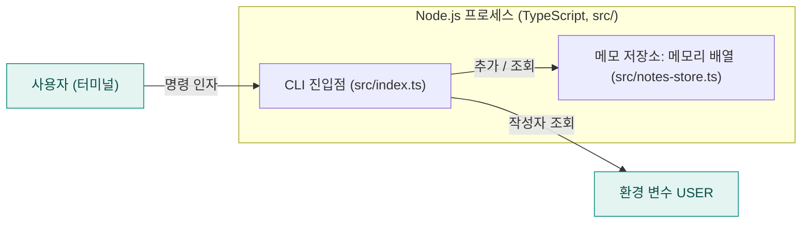
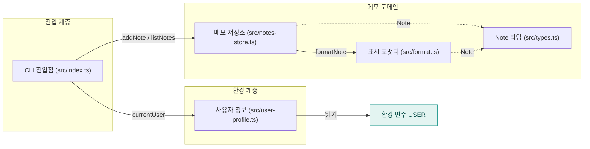

<!-- codemap: generated file — hand edits outside a manual-edit block are replaced by /codemap refresh -->

# 아키텍처 개요

`notes-cli`는 터미널에서 메모를 추가하고 목록을 보는 작은 TypeScript 명령줄 도구이며, 아래에서 세 단계의 확대 수준으로 구조를 보여 줍니다.

## 1단계: 시스템 컨텍스트

사용자가 터미널에서 `notes add`나 `notes list`를 실행하고, 도구는 작성자 이름을 얻기 위해 환경 변수 `USER`를 읽습니다(`src/user-profile.ts`). 데이터베이스나 네트워크 API 호출은 코드에서 찾지 못했습니다.

## 2단계: 컨테이너

배포 단위는 하나의 CLI 프로세스뿐이며, 메모는 이 프로세스 안의 배열(`const notes: Note[] = []`)에만 저장되어 프로세스가 끝나면 사라집니다. `package.json`의 `bin`은 `notes`를 빌드 산출물 dist/index.js로 연결하고, `npm run build`는 `tsc`를 실행합니다.

## 3단계: 컴포넌트

`src/index.ts`가 명령을 해석해 `src/notes-store.ts`와 `src/user-profile.ts`를 호출하고, 저장소는 `src/format.ts`로 한 줄 문자열을 만들며, 점선은 타입만 가져오는 의존입니다.

| 컴포넌트 | 책임 |
|---|---|
| `src/index.ts` | `process.argv`를 읽어 `add` / `list` / 사용법 오류로 분기 |
| `src/notes-store.ts` | 메모리 배열에 메모 추가(`addNote`), 포맷된 줄 목록 반환(`listNotes`) |
| `src/format.ts` | `#id 본문 (작성자)` 형식의 문자열 생성(`formatNote`) |
| `src/user-profile.ts` | `USER` 환경 변수 또는 `"anonymous"` 반환(`currentUser`) |
| `src/types.ts` | `Note` 인터페이스(`id`, `text`, `author`) 정의 |

## 다루지 않은 범위

소스 파일 5개(`src/` 전체)와 `README.md`, `package.json`, `tsconfig.json`을 모두 읽었습니다. 빌드 산출물 dist/와 node_modules/는 저장소에 없어 읽지 않았습니다.
