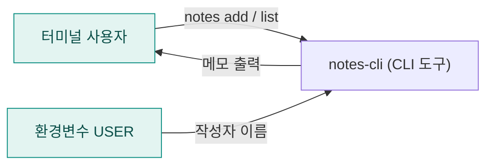
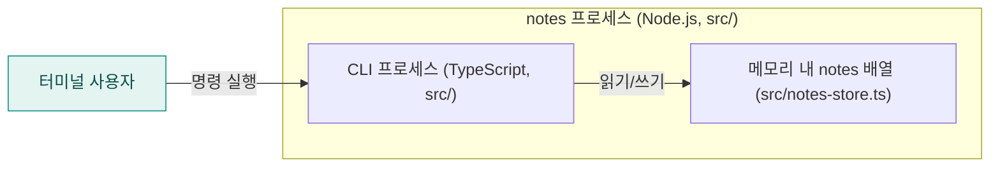
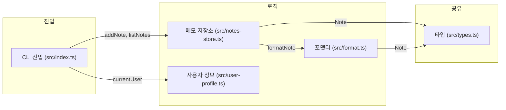

<!-- codemap: generated file — hand edits outside a manual-edit block are replaced by /codemap refresh -->

# 아키텍처 개요

`notes-cli`는 터미널에서 메모를 추가하고 목록으로 보는 작은 TypeScript 명령줄 도구이며, 아래에 세 단계의 확대 수준으로 구조를 그렸습니다.

## 1. 시스템 컨텍스트

사용자가 `notes` 명령을 실행하면 도구가 환경변수 `USER`에서 작성자 이름을 읽고 결과를 터미널에 출력합니다(`src/index.ts`, `src/user-profile.ts`).

## 2. 컨테이너

배포 단위는 `package.json`의 `bin`이 가리키는 단일 CLI 하나이고, 저장소는 별도 DB 없이 프로세스 메모리의 배열뿐이라 명령이 끝나면 메모는 사라집니다.

## 3. 컴포넌트

`src/index.ts`가 명령을 해석해 저장소와 사용자 정보 모듈을 부르고, 저장소는 출력 문자열 생성을 `src/format.ts`에 맡기며, `Note` 타입은 `src/types.ts` 한 곳에 정의됩니다.

## 다루지 않은 범위

`tsconfig.json`은 읽지 않았고, 빌드 산출물 `dist/`는 저장소에 없어 보지 못했습니다. 나머지 소스 5개는 모두 끝까지 읽었습니다.
