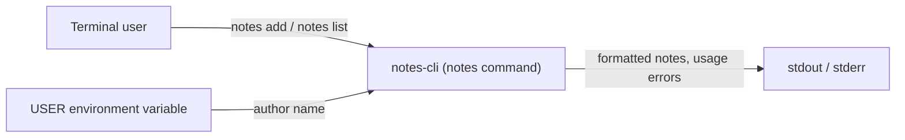
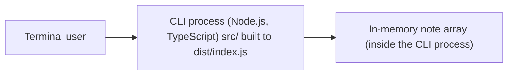
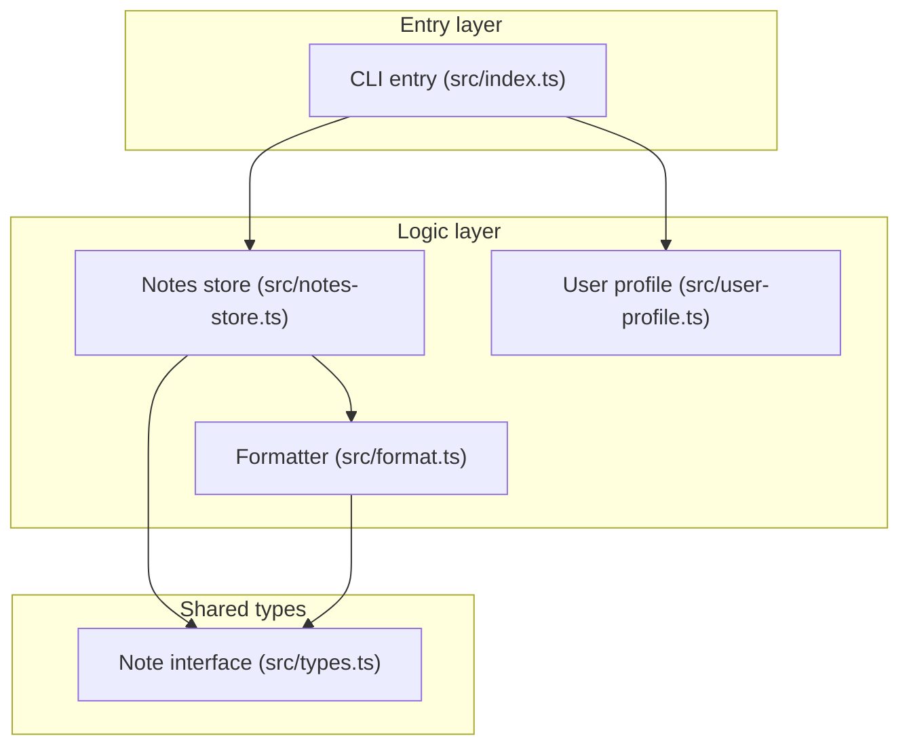

<!-- codemap: generated file — hand edits outside a manual-edit block are replaced by /codemap refresh -->

# Architecture overview

`notes-cli` is a small TypeScript command-line notes tool, shown here at three zoom levels.

## Level 1: System context

The user runs the `notes` command; the tool reads the author from the `USER` environment variable and prints to the terminal.

## Level 2: Containers

There is a single container, the Node.js CLI process (`bin` in `package.json`); notes live only in that process's memory, with no database or file storage.

## Level 3: Components

`src/index.ts` parses the command and delegates to `src/notes-store.ts` and `src/user-profile.ts`; the store uses `src/format.ts` for output, and both share the `Note` type from `src/types.ts`.

## Notes

- The notes array is a module-level variable in `src/notes-store.ts`, so notes do not survive between runs of the command.

## Not covered

Nothing was skipped: all five files under `src/` plus `package.json`, `tsconfig.json` and `README.md` were read. The build output folder dist/ does not exist in the repo.
