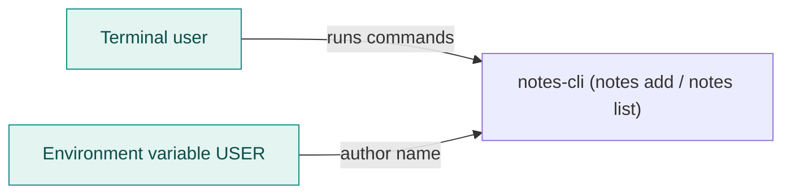
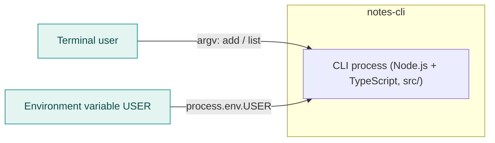
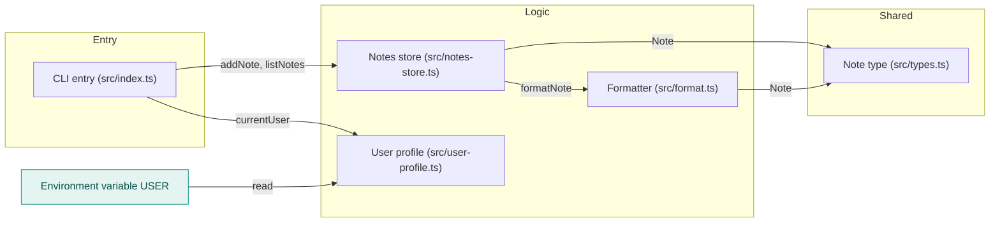

<!-- codemap: generated file — hand edits outside a manual-edit block are replaced by /codemap refresh -->

# Architecture overview

`notes-cli` is a small TypeScript command-line notes tool (`package.json` declares the `notes` binary as build output `dist/index.js`), shown here at three zoom levels.

## Level 1: System context

A person runs `notes add` or `notes list` in a terminal, and the tool reads the `USER` environment variable (`src/user-profile.ts`) to name the author.

## Level 2: Containers

There is a single container: one Node.js process started from `src/index.ts`; notes live in a module-level array inside that process (`src/notes-store.ts`), so nothing is saved to disk or to a database and each run starts empty.

## Level 3: Components

`src/index.ts` parses the command and delegates to the store and the user profile, while the store uses the formatter to turn notes into display lines and all three share the `Note` interface.

## Not covered

The small repo was read completely, except `tsconfig.json`, which was not opened, so compiler settings are not described. Nothing is vendored, and the build output folder dist/ does not exist in the repo.
