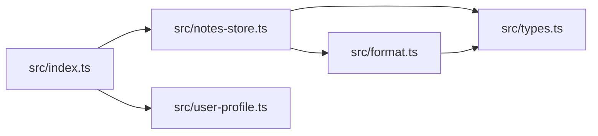

<!-- codemap: generated file — hand edits outside a manual-edit block are replaced by /codemap refresh -->

# Dependency graph

Arrows point from the importing file to the file it imports, taken from the `import` statements in the five source files.

The graph is a tree-like chain from the entry file `src/index.ts` down to `src/types.ts`, and `src/user-profile.ts` imports nothing from the project.

## Circular dependencies

None found: no file reaches itself through its imports, and there are no self-imports.

## Most depended-on files

- `src/types.ts` — imported by `src/notes-store.ts` and `src/format.ts` (2 incoming edges; it holds only the `Note` interface).
- `src/notes-store.ts` — imported by `src/index.ts` (1 incoming edge).
- `src/user-profile.ts` — imported by `src/index.ts` (1 incoming edge).
- `src/format.ts` — imported by `src/notes-store.ts` (1 incoming edge).

## Not covered

The small repo was read completely: every `.ts` file under `src/` was opened. Imports of built-in or third-party packages were ignored (none exist), and no dynamic imports were found.
