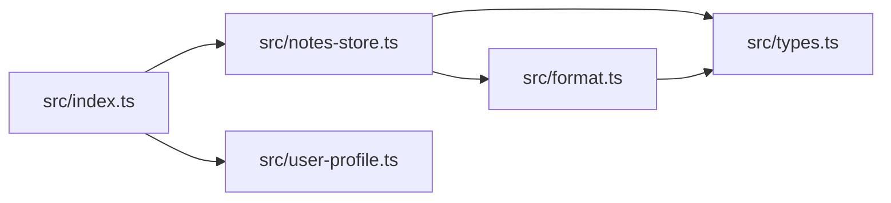

# Dependency graph

Which source file imports which, taken from the `import` statements in `src/`.

Arrows point from the importing file to the imported file; `src/user-profile.ts` imports nothing from the project.

## Circular dependencies

None found. All five files form an acyclic graph.

## Most depended-on files

- `src/types.ts`: imported by `src/notes-store.ts` and `src/format.ts` (2 incoming edges).
- `src/notes-store.ts`: imported by `src/index.ts` (1).
- `src/format.ts`: imported by `src/notes-store.ts` (1).
- `src/user-profile.ts`: imported by `src/index.ts` (1).

## Not covered

Nothing was skipped; every file under `src/` was read. Imports of third-party packages: none exist (only Node's global `process` is used).
