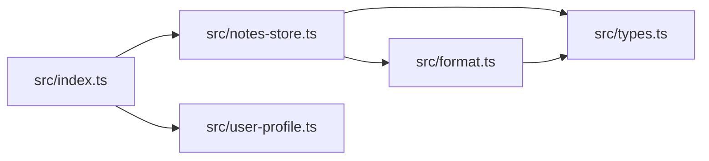

<!-- codemap: generated file — hand edits outside a manual-edit block are replaced by /codemap refresh -->

# 의존성 그래프

`src/` 아래 5개 파일의 `import` 문을 직접 읽어, 가져오는 파일에서 가져와지는 파일 방향으로 그린 그래프입니다.

`src/index.ts`가 최상위이고 `src/types.ts`가 가장 아래에 있으며, `src/user-profile.ts`는 프로젝트 내부 파일을 가져오지 않습니다.

## 순환 의존

순환 의존은 발견되지 않았습니다. 5개 파일 사이의 5개 import 간선에는 서로를 거쳐 되돌아오는 경로가 없고, 자기 자신을 가져오는 파일도 없습니다.

## 가장 많이 의존되는 파일

- `src/types.ts`: 들어오는 간선 2개(`src/notes-store.ts`, `src/format.ts`)
- `src/notes-store.ts`: 들어오는 간선 1개(`src/index.ts`)
- `src/user-profile.ts`: 들어오는 간선 1개(`src/index.ts`)
- `src/format.ts`: 들어오는 간선 1개(`src/notes-store.ts`)

## 다루지 않은 범위

`src/`의 소스 파일 5개를 모두 읽었고, 동적 import나 `require` 호출은 없었습니다. 외부 패키지 import도 없어 제외한 것이 없습니다. 빌드 산출물 dist/와 node_modules/는 저장소에 없습니다.
