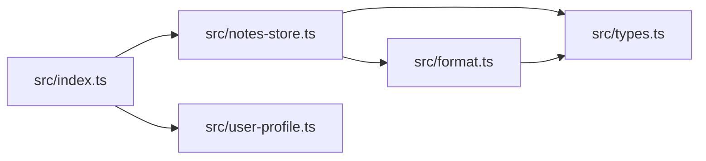

<!-- codemap: generated file — hand edits outside a manual-edit block are replaced by /codemap refresh -->

# 의존성 그래프

`src` 안의 파일 5개가 실제 `import` 문으로 서로 연결된 모습이며, 화살표는 가져오는 쪽에서 가져오는 대상으로 향합니다.

`src/index.ts`가 맨 위에서 두 모듈을 가져오고, 모든 길이 `src/types.ts`로 모입니다.

## 순환 의존

읽은 `import` 문 5개 파일 안에서 순환 의존과 자기 자신을 가져오는 경우는 발견되지 않았습니다.

## 가장 많이 가져다 쓰는 파일

- `src/types.ts` — 2곳(`src/notes-store.ts`, `src/format.ts`)에서 `Note`를 가져옵니다.
- `src/notes-store.ts` — `src/index.ts`가 `addNote`, `listNotes`를 가져옵니다.
- `src/user-profile.ts` — `src/index.ts`가 `currentUser`를 가져옵니다.
- `src/format.ts` — `src/notes-store.ts`가 `formatNote`를 가져옵니다.

## 다루지 않은 범위

외부 패키지 import는 없었고, 동적 import도 발견되지 않았습니다. `tsconfig.json`과 빌드 산출물 `dist/`는 읽지 않았으며, 나머지 소스 5개는 모두 읽었습니다.
