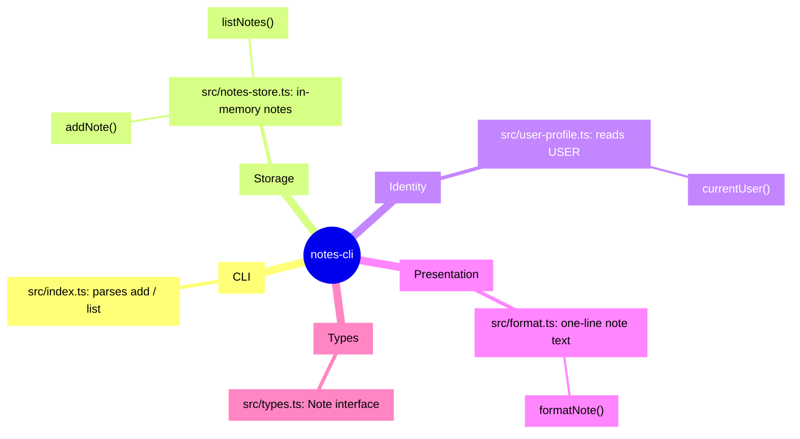

# Mindmap

The `notes-cli` project at a glance, grouped by what the code does.

The five groups map one-to-one onto the five files in `src/`.

## Groups

- CLI: command-line entry and usage message.
- Storage: keeps notes in a module-level array and adds or lists them.
- Identity: picks the author name from `USER`, falling back to "anonymous".
- Presentation: turns a `Note` into a printable line.
- Types: the shared `Note` shape (`id`, `text`, `author`).

## Not covered

Nothing was skipped; the whole repository was read.
