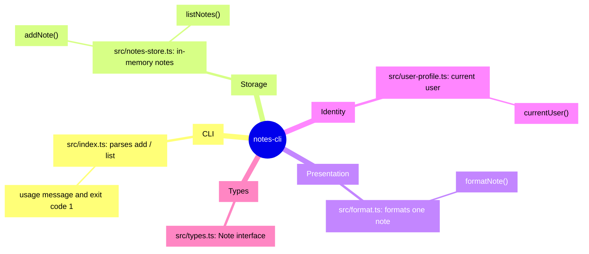

<!-- codemap: generated file — hand edits outside a manual-edit block are replaced by /codemap refresh -->

# Mindmap

The `notes-cli` project at a glance, grouped by what the code does.

The five source files split into five small responsibilities, one file each.

## Groups

- **CLI** — turns `notes add <text>` and `notes list` into calls; anything else prints a usage line and exits with 1.
- **Storage** — keeps notes in a module-level array and assigns ids as length + 1.
- **Presentation** — renders a note as `#id text (author)`.
- **Identity** — author name from the `USER` environment variable, falling back to `anonymous`.
- **Types** — the shared `Note` shape (`id`, `text`, `author`).

## Not covered

All source files were read completely; nothing was left out. `package.json`, `tsconfig.json` and `README.md` are configuration or docs and are not shown in the map.
