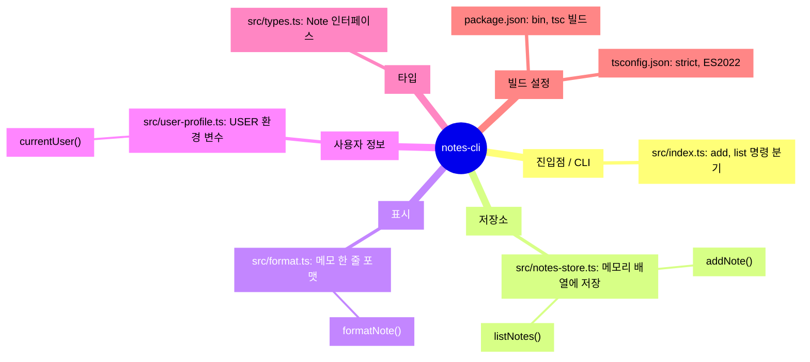

<!-- codemap: generated file — hand edits outside a manual-edit block are replaced by /codemap refresh -->

# 마인드맵

`notes-cli`를 기능별로 묶어 한눈에 보여 주는 마인드맵입니다.

각 가지는 한 가지 책임을 맡고, 그 아래에 실제로 읽은 파일과 대표 함수를 두었습니다.

## 그룹

- 진입점 / CLI: 명령줄 인자를 읽어 `add`, `list` 또는 사용법 오류로 분기합니다(`src/index.ts`).
- 저장소: 메모를 프로세스 메모리의 배열에 쌓고 조회합니다(`src/notes-store.ts`).
- 표시: `Note` 하나를 `#id 본문 (작성자)` 문자열로 바꿉니다(`src/format.ts`).
- 사용자 정보: 작성자 이름으로 쓸 현재 사용자를 돌려줍니다(`src/user-profile.ts`).
- 타입: 모듈 사이에서 공유하는 `Note` 형태를 정의합니다(`src/types.ts`).
- 빌드 설정: `notes` 실행 파일 선언과 TypeScript 컴파일 옵션입니다(`package.json`, `tsconfig.json`). 빼 둔 항목은 없습니다.

## 다루지 않은 범위

소스 파일 5개와 설정 파일 2개를 모두 읽었습니다. 빌드 산출물 dist/와 node_modules/는 저장소에 없습니다.
